## Conexión

**JDBC** (Java Database Connectivity) es una API estándar de Java que permite a los programas escritos en Java (y por extensión en Kotlin) conectarse y trabajar con bases de datos relacionales.

En la introducción ya vimos que un **conector** (también llamado driver) es una librería software que permite que una aplicación se comunique con un gestor de base de datos (SGBD). Actúa como un puente entre nuestro código y la base de datos, traduciendo las instrucciones SQL a un lenguaje que el gestor puede entender y viceversa. Sin un conector, tu aplicación no podría comunicarse con la base de datos.

**Para conectarse a una base de datos mediante JDBC desde Java o Kotlin necesitamos:**

| Elemento | Para qué sirve | Ejemplo |
|---|---|---|
| **Driver o conector JDBC** | Permite comunicarse con el gestor elegido. Se añade como dependencia del proyecto. | org.postgresql:postgresql:42.7.1|
| **URL de conexión** | Indica el gestor y la ubicación de la base de datos. | jdbc:postgresql://localhost:5432/geo |
| **Credenciales, si se requieren** | Identifican al usuario y permiten acceder a la base de datos. | Usuario y contraseña de PostgreSQL. |
| **Base de datos accesible** | Debe estar disponible en la ubicación indicada. | Un fichero SQLite o un servidor PostgreSQL en funcionamiento. |


!!!Note "Para saber más"
    - **Código estándar**: gracias a JDBC, el mismo código Java/Kotlin puede trabajar con distintas bases de datos cambiando solo la URL y el driver.
    - En herramientas gráficas como **DBeaver**, los drivers se gestionan automáticamente.
    - En **proyectos en código**, los drivers se añaden como dependencia (por ejemplo, en Maven, Gradle…).

**Principales formas de conectarse a una base de datos**{.azul}


| Medio de conexión                         | Descripción                                                                 |
|-------------------------------------------|-----------------------------------------------------------------------------|
| 🖥️ Aplicaciones de escritorio             | Herramientas gráficas como **DBeaver**, **pgAdmin**, **MySQL Workbench**, **DB Browser for SQLite**. Permiten explorar, consultar y administrar BD de forma visual. |
| 💻 Aplicaciones desarrolladas en código   | Programas en **Kotlin**, **Java**, **Python**, **C#**, etc., mediante **conectores**{.verde} como **JDBC**, **psycopg2**, **ODBC**, etc. para acceder a BD desde código. |
| 🔠 Línea de comandos                      | Clientes como `psql` (PostgreSQL), `mysql`, `sqlite3`. Permiten ejecutar comandos SQL directamente desde terminal. |
| 🌐 Aplicaciones web                        | Sitios web que acceden a BD desde el backend (por ejemplo, en Spring Boot, Node.js, Django, etc.). |
| 🔄 APIs REST o servidores intermedios     | Servicios web que conectan la BD con otras aplicaciones, actuando como puente o capa de seguridad. |
| 📱 Aplicaciones móviles                   | Apps Android/iOS que acceden a BD locales (como **SQLite**) o remotas (vía **Firebase**, API REST, etc.). |
| 📂 Herramientas de integración de datos   | Software como **Talend**, **Pentaho**, **Apache Nifi** para migrar, transformar o sincronizar datos entre sistemas. |


!!!Tip ""
    En los siguientes apartados veremos como conectarnos a una BD Relacional, [Tienda.sqlite](../Tienda.sqlite), tanto desde la herramienta gráfica de BD integrada de **IntelliJ**  como desde la herramienta universal para la gestión de bases de datos **DBeaver** y también desde una aplicación desarrollada en **Kotlin**.

## 🔹 Desde IntelliJ


**IntelliJ** incorpora una potente herramienta de gestión de bases de datos que permite visualizar la base de datos directamente desde el entorno de desarrollo (IDE), lo que permite:


- 📂 Explorar la estructura de la base de datos (tablas, vistas, claves, relaciones…)
- 🔎 Consultar datos en tiempo real con editores SQL integrados
- 🛠️ Modificar tablas, añadir registros o ejecutar scripts SQL sin salir del proyecto
- ⚡ Ver los cambios reflejados inmediatamente tras ejecutar una operación desde el código
- ✅ Probar consultas antes de implementarlas en el programa

Las siguientes imágenes muestran cómo configurar esta herramienta para conectarnos a la BD de ejemplo
[Tienda.sqlite](../Tienda.sqlite), disponible también en Aules:


**1. Crea un nuevo proyecto en Kotlin y Gradle**{.azul}

Al nuevo proyecto lo llamaremos **BDRelacionales**.

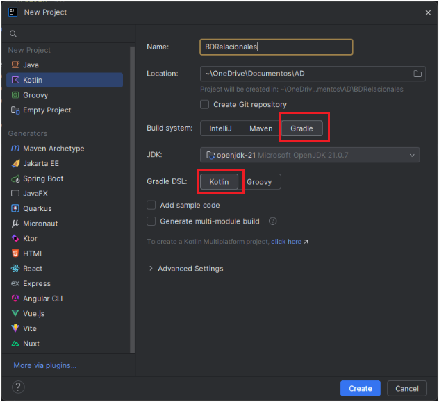


**2. Copia el archivo de la BD a nuestro proyecto**{.azul}

La ubicaremos en **`src/main/resources/Tienda.sqlite`**. La carpeta `resources` forma parte del **classpath** del proyecto. Allí se colocan archivos que necesita la aplicación en tiempo de ejecución. Cuando compilas el proyecto, su contenido se copia al resultado de la compilación, manteniendo la misma estructura. Además, si compartes el proyecto, la base de datos viaja con él.

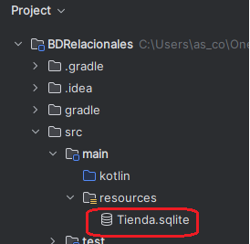

**3. Elige el conector a la base de datos**{.azul}

En la herramienta **Database -> Data Source** elegimos el conector **SQLite**. 

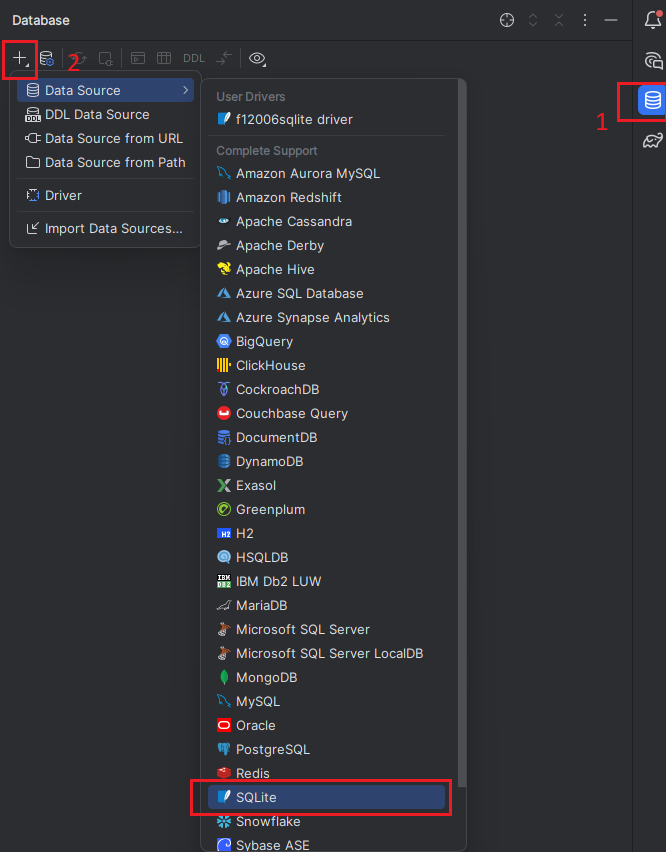


**4. Selecciona la ubicación de la BD**{.azul}


Podemos comprobar la conexión con **Test Connection** antes de aceptar.

Al aceptar, se nos pedirá que instalemos **el driver** correspondiente, si no estuviera instalado.

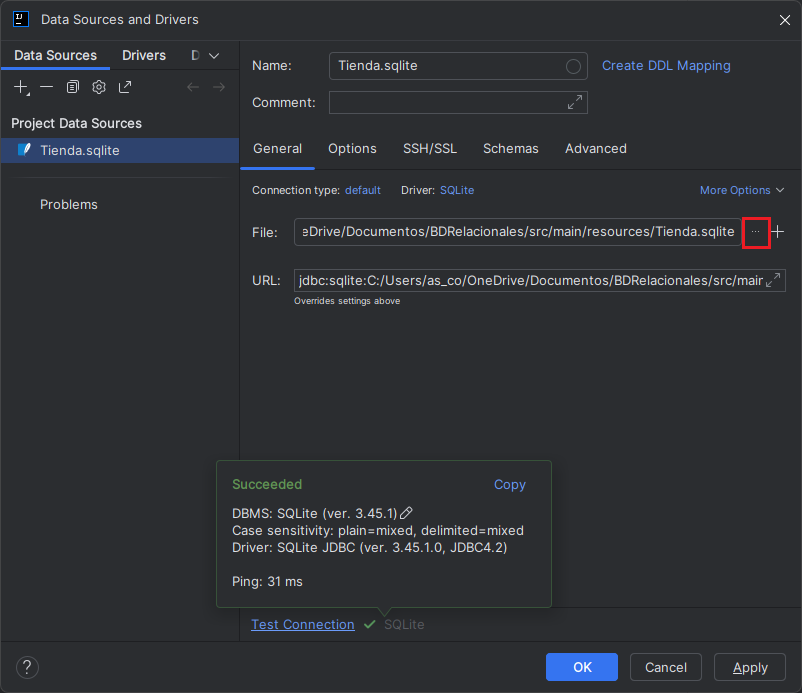

**5. Comprueba consultas antes de implementarlas**{.azul}


 Una vez configurado el acceso a la BD podemos ver en diferentes ventanas la estructura de la BD y el resultado de ejecutar las sentencias SQL, haciendo click derecho sobre la conexión y seleccionando la opción **New > QueryConsole**.

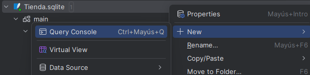

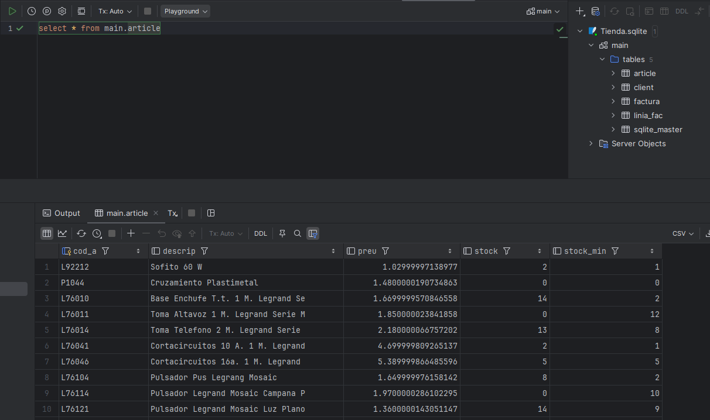


## 🔹 Desde DBeaver


**DBeaver** es una herramienta gráfica y gratuita que permite gestionar múltiples bases de datos de forma visual. Los pasos para conectarse a la BD [Tienda.sqlite](../Tienda.sqlite), disponible en Aules, son los siguientes:


**1. Abre DBeaver**{.azul}

Inicia el programa **DBeaver**. Aparecerá la ventana principal con el panel lateral de conexiones.

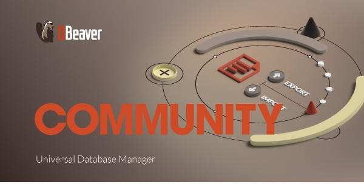

Haz clic en el botón **"Nueva conexión"** (ícono de enchufe) o ve al menú **Archivo > Nueva conexión**.

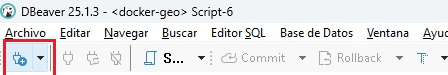

---


**2. Selecciona el tipo de base de datos**{.azul}

En la ventana de selección, elige **SQLite** y pulsa **Siguiente**.

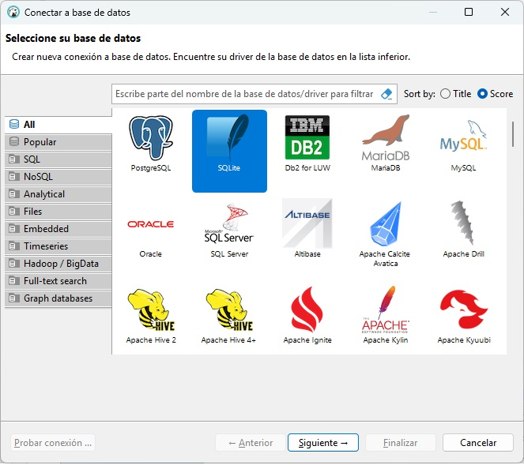


---

**3. Introduce la ruta donde se encuentra la BD**{.azul}


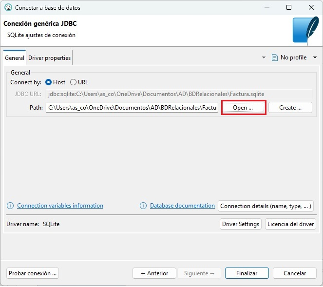


---

**4. Prueba la conexión**{.azul}

Haz clic en **"Probar conexión"**. Si todo está correcto, verás un mensaje de éxito.  
Si DBeaver necesita un controlador (driver), te lo ofrecerá para descargar automáticamente.


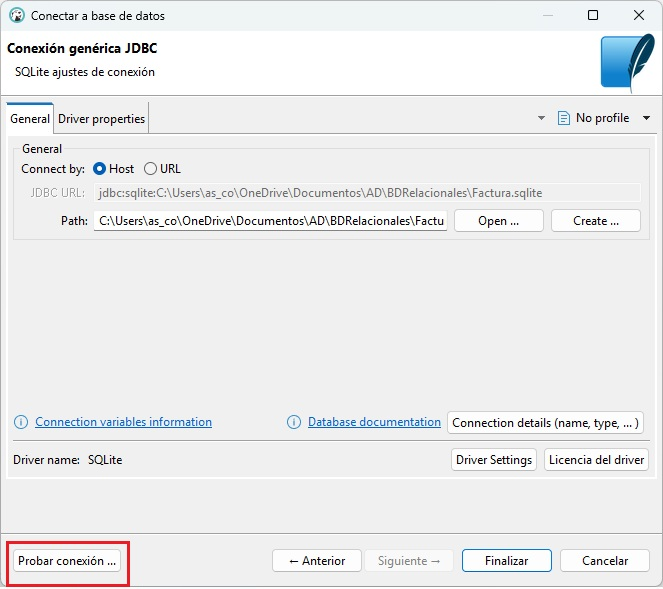


---

**5. Finaliza y explora**{.azul}

Haz clic en **"Finalizar"**. La nueva conexión aparecerá en el panel lateral izquierdo.  
Desde allí puedes:

- Ver tablas, vistas, funciones y procedimientos
- Ejecutar sentencias SQL
- Consultar y modificar registros
- Exportar datos en distintos formatos

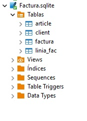


## 🔹 Desde Kotlin


Para que una aplicación (escrita en Kotlin, Java u otro lenguaje) pueda leer, insertar o modificar información almacenada en una base de datos relacional (BDR), debe establecer una conexión con ella. Esto implica una serie de **pasos técnicos** y el uso de componentes específicos:

- Conectarse al gestor de base de datos (PostgreSQL, MySQL, SQLite…)
- Enviar consultas SQL (SELECT, INSERT, UPDATE, DELETE…)
- Recibir y procesar resultados (ResultSet, listas de objetos…)
- Cerrar correctamente los recursos utilizados


!!!Tip "Kotlin - Instrucciones"
    En el proyecto `BDRelacionales`, ya creado y conectado a la BD `Tienda.sqlite`, crearemos un **paquete** nuevo llamado `SQLite`. En este paquete incluiremos los ejemplos de este apartado.

    La base de datos debe estar en `src/main/resources/Tienda.sqlite`.

    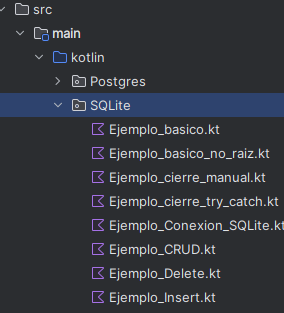


Para que la conexión funcione, es necesario **añadir el conector JDBC** correspondiente. Para ello utilizaremos la herramienta **Gradle**, que permite automatizar la gestión de dependencias sin tener que configurar nada a mano.

- **build.gradle.kts** : 

```kotlin
        dependencies {
            implementation("org.xerial:sqlite-jdbc:3.43.0.0") //SQLite
        }
```


**Ejemplo de conexión a SQLite**{.azul}

**Ejemplo_Conexion_SQLite.kt**: El siguiente programa conecta con la BD **Tienda.sqlite**.

```kotlin
        package SQLite

        import java.io.File
        import java.sql.DriverManager

        fun main() {
            // Ruta al archivo de base de datos SQLite
            val dbPath = "src/main/resources/Tienda.sqlite"
            val dbFile = File(dbPath)
            println("Ruta de la BD: ${dbFile.absolutePath}")

            val url = "jdbc:sqlite:${dbFile.absolutePath}" // (1)!

            // Conexión y prueba
            DriverManager.getConnection(url).use { conn -> // (2)!
                println("Conexión establecida correctamente con SQLite.")
            }


        }

```

1. La URL JDBC identifica el controlador `sqlite` y la ruta absoluta del archivo que se abrirá.
2. `DriverManager` solicita la conexión al controlador JDBC. `use` garantiza su cierre automático al terminar el bloque.

!!!Note "Recuerda"
    No se necesita usuario ni contraseña con SQLite, ya que es una base de datos local y embebida.


!!!Tip "Buenas prácticas"
    Podemos encapsular la conexión a la base de datos dentro de un objeto, de manera que pueda reutilizarse tantas veces como sea necesario. Así evitamos duplicar código y reducimos posibles errores. Por ejemplo, si la base de datos cambia de ubicación, solo habría que actualizar la ruta en el objeto y no en cada uno de los programas.

**Ejemplo_Conexion_SQLite_obj.kt**

```kotlin
        package SQLite

        import java.io.File
        import java.sql.DriverManager

        object DatabaseTienda {


            // Ruta al archivo de base de datos SQLite
            val dbPath = "src/main/resources/Tienda.sqlite"
            val dbFile = File(dbPath)
            val url = "jdbc:sqlite:${dbFile.absolutePath}" // (1)!

            fun getConnection() = DriverManager.getConnection(url) // (2)!

        }

```

1. La conexión queda configurada una sola vez para todos los ejemplos que utilizan `Tienda.sqlite`.
2. Cada llamada devuelve una conexión nueva. Quien la solicite debe cerrarla, normalmente mediante `use`.

**Ejemplo_basico_conexion_objeto.kt**

```kotlin
            package SQLite

            fun main() {
                val sql = "SELECT * FROM article"
                DatabaseTienda.getConnection().use { conn -> // (1)!
                    conn.prepareStatement(sql).use { stmt -> // (2)!
                        stmt.executeQuery().use { rs -> // (3)!

                            while (rs.next()) { // (4)!

                                //código
                            }
                        }
                    }
                }
            }
```

1. Se obtiene una conexión reutilizando el objeto común `DatabaseTienda`.
2. `prepareStatement` prepara la sentencia SQL antes de ejecutarla.
3. Una consulta `SELECT` devuelve un `ResultSet`, que también se cierra con `use`.
4. `next()` avanza a la siguiente fila y devuelve `false` cuando ya no quedan resultados.


