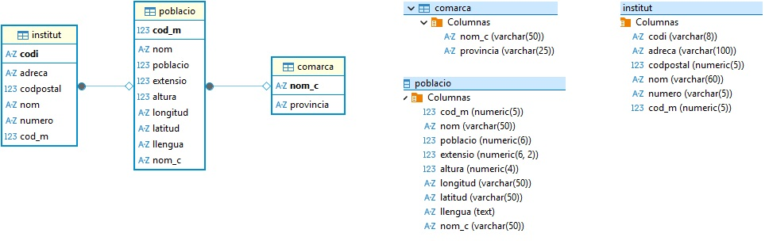
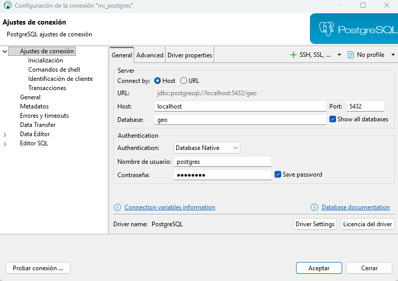

# Preparación de PostgreSQL y la BD geo

Hasta ahora hemos trabajado con ejemplos de operaciones **CRUD** (Crear, Leer, Actualizar y Borrar) utilizando **SQLite**, una base de datos ligera, fácil de usar y sin necesidad de servidor, ideal para iniciarse en el acceso a datos desde Kotlin.

Sin embargo, en entornos reales y profesionales, lo más habitual es trabajar con sistemas de gestión de bases de datos más potentes y completos, como **PostgreSQL**.

Actualmente trabajaremos con **PostgreSQL** en entorno local, replicando la base de datos mediante **Docker**. Este enfoque garantiza que todos los equipos tengan la misma configuración y evita depender de servicios remotos externos.

Opcionalmente, también se puede usar una instalación local nativa de PostgreSQL con los mismos scripts y consultas.


Vamos a replicar la base de datos **`geo`** en un servidor PostgreSQL ejecutado dentro de un **contenedor Docker**, creando sus tablas y cargando los datos necesarios para las prácticas. La imagen del modelo relacional que aparece a continuación muestra la estructura de esta base de datos: las tablas `comarca`, `poblacio` e `institut`, sus campos y las relaciones entre ellas.

**Esquema de la BD `geo`**{.azul}





!!!Tip "Pasos para replicar la BD geo en Docker"
    1. Se instala **PostgreSQL** con **Docker** usando un `docker-compose.yml`.  
    2. Se arranca el contenedor y se verifica con `docker ps`.  
    3. Se conecta la base de datos con **DBeaver** (`localhost:5432`).  
    4. Se crean las tablas `COMARCA`, `POBLACIO` e `INSTITUT`.  
    5. Se insertan los datos iniciales desde los scripts `.sql`.

---

## 1️⃣ Instalación de PostgreSQL con 🐳 Docker

Para crear un contenedor de **PostgreSQL** en nuestro equipo utilizaremos **Docker Compose**.

> 💡 Si eres usuario de **Windows** o **Mac**, instala **Docker Desktop**.  
> Después de instalarlo, inicia **Docker Desktop** y espera a que indique que Docker está en ejecución antes de continuar.  
> Si usas **Ubuntu** o **Debian**, asegúrate de tener instalados Docker Engine y el complemento Docker Compose.

---

### 1.1. Docker-compose.yml

Para configurar y gestionar los servicios de la aplicación mediante Docker Compose, es necesario crear un archivo de configuración que defina los servicios y sus parámetros.

Crea un archivo llamado **docker-compose.yml** con el contenido que se indica a continuación. Puedes guardarlo en cualquier carpeta de tu sistema.


```yaml
services:
  db:
    image: postgres:16.4
    container_name: mi_postgres
    environment:
      POSTGRES_PASSWORD: postgres
      POSTGRES_USER: postgres
      POSTGRES_DB: geo
    volumes:
      - db_data:/var/lib/postgresql/data
    ports:
      - "5432:5432"

volumes:
  db_data:
```

!!! warning "Solo para el entorno de prácticas"
    Las credenciales `postgres/postgres` simplifican el trabajo en local. No deben utilizarse en producción ni en un servidor accesible desde Internet.


### 1.2. Levantar el servicio

Posiciónate en el terminal en el directorio donde está el fichero `docker-compose.yml` y ejecuta:

```shell
docker compose up -d
```


### 1.3. Verificar el contenedor

Para comprobar que PostgreSQL está activo, ejecuta en el terminal:

```shell
docker ps
```


El resultado debe mostrar una entrada similar a la siguiente:

```text
    CONTAINER ID  IMAGE         COMMAND                  CREATED        STATUS       PORTS                   NAMES
    327fd50443a7  postgres:16.4  "docker-entrypoint.s…"   2 minutes ago  Up 2 minutes  0.0.0.0:5432->5432/tcp  mi_postgres
```


Si aparece el contenedor mi_postgres con estado Up, significa que el servicio de PostgreSQL está funcionando correctamente.


## 2️⃣ Conexión de PostgreSQL con DBeaver

Una vez el contenedor de PostgreSQL está activo, podemos conectarnos mediante el cliente gráfico **DBeaver**.

---

### 2.1. Crear nueva conexión

1. Abre **DBeaver**.  
2. Selecciona **Nueva conexión → PostgreSQL**.  
3. Introduce los siguientes datos de conexión:

<div class="conexion-dbeaver">
<div class="conexion-dbeaver__layout">
<table>
<thead>
<tr><th>Campo</th><th>Valor</th></tr>
</thead>
<tbody>
<tr><td>Nombre de conexión</td><td><code>mi_postgres</code></td></tr>
<tr><td>Server host</td><td><code>localhost</code></td></tr>
<tr><td>Port</td><td><code>5432</code></td></tr>
<tr><td>Database</td><td><code>geo</code></td></tr>
<tr><td>User name</td><td><code>postgres</code></td></tr>
<tr><td>Password</td><td><code>postgres</code></td></tr>
</tbody>
</table>

</div>
</div>


Haz clic en **Test Connection** para comprobar la conexión.  

---

## 3️⃣ Creación de la base de datos `geo`

En la conexión local de PostgreSQL (ya desde DBeaver o cualquier cliente SQL), ejecuta los siguientes scripts para crear las tablas del esquema `public`.

---

### 3.1. Creación de la tabla `COMARCA`

```sql
    CREATE TABLE public.comarca (
        nom_c varchar(50) NOT NULL,
        provincia varchar(25) NULL,
        CONSTRAINT cp_com PRIMARY KEY (nom_c)
    );
```


### 3.2. Creación de la tabla `POBLACIO`

```sql
    CREATE TABLE public.poblacio (
        cod_m numeric(5) NOT NULL,
        nom varchar(50) NOT NULL,
        poblacio numeric(6) NULL,
        extensio numeric(6, 2) NULL,
        altura numeric(4) NULL,
        longitud varchar(50) NULL,
        latitud varchar(50) NULL,
        llengua bpchar(1) NULL,
        nom_c varchar(50) NULL,
        CONSTRAINT cp_pobl PRIMARY KEY (cod_m),
        CONSTRAINT ce_pob_com FOREIGN KEY (nom_c)
            REFERENCES public.comarca(nom_c)
            ON UPDATE CASCADE
    );
```

### 3.3. Creación de la tabla `INSTITUT`

```sql
    CREATE TABLE public.institut (
        codi varchar(8) NOT NULL,
        nom varchar(60) NULL,
        adreca varchar(100) NULL,
        numero varchar(5) NULL,
        codpostal numeric(5) NULL,
        cod_m numeric(5) NULL,
        CONSTRAINT cp_ins PRIMARY KEY (codi),
        CONSTRAINT ce_ins_pob FOREIGN KEY (cod_m)
            REFERENCES public.poblacio(cod_m)
    );
```

## 4️⃣ Carga de datos iniciales {#carga-datos}

Para completar la base de datos, ejecuta los siguientes scripts SQL desde **DBeaver** o desde el terminal de **PostgreSQL**.

Cada script se encarga de insertar los datos de las tablas creadas previamente.

---

📂 [Inserción de comarcas](comarcas.sql)

📂 [Inserción de poblacio](poblacions.sql)

📂 [Inserción de insitut](instituts.sql)

Una vez preparadas las tablas y los datos, continúa con la [conexión a PostgreSQL desde Kotlin](Conectores.md#conexion-postgresql).
