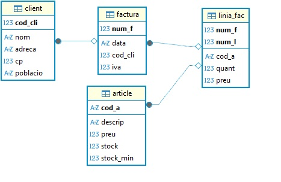
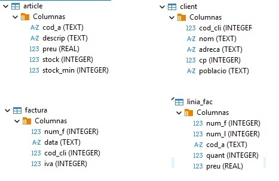

# Entorno y BD Tienda

!!!Tip "Kotlin - Instrucciones"
    Dentro del paquete `SQLite` del proyecto `BDRelacionales`, ya creado y conectado a la BD [Tienda.sqlite](Tienda.sqlite), ubicada en la carpeta de **recursos**, incluiremos los ejemplos de este apartado.
    Estos ejemplos mostrarán cómo gestionar datos desde una aplicación en Kotlin conectada a una base de datos relacional ligera, utilizando las tablas `article`, `client`, `factura` y `linia_fac`, tal y como se aprecia en el modelo relacional de la siguiente imagen.

**Tienda.sqlite**{.azul}

Modelo Relacional|Datos|
--|--
||

**Paquete SQLite**{.azul}

|