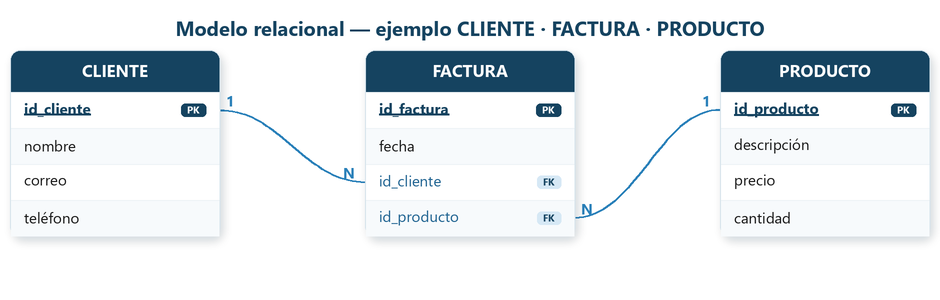

# Introducción

Aunque en el módulo de Bases de Datos de 1º de DAM ya se estudiaron en profundidad, conviene repasar brevemente algunos conceptos clave de las bases de datos relacionales, ya que en este módulo (Acceso a Datos) trabajaremos con ellas desde el código.

En este módulo no nos centraremos en diseñar bases de datos (eso ya se vio), sino en conectarnos a ellas desde el código, consultar datos, modificarlos y automatizar operaciones con funciones, procedimientos y transacciones.

Antes de ejecutar los ejemplos, revisa el [entorno y la ubicación de los ejemplos](Entorno.md).

## 🔹 Bases de datos relacionales

Una **base de datos relacional (BDR)** es un sistema de almacenamiento de información que **organiza los datos en tablas** compuestas por filas y columnas, donde cada fila representa un registro único y cada columna contiene un atributo específico de ese registro. Estas BD siguen el **Modelo Relacional**, desarrollado por Edgar F. Codd en la década de 1970, y permite establecer vínculos o **relaciones entre diferentes tablas** mediante **claves primarias y foráneas**, facilitando así la integridad, la coherencia y la eficiencia en el manejo de grandes volúmenes de datos.

La principal ventaja de las bases de datos relacionales es su capacidad para estructurar la información de manera lógica y accesible, permitiendo a los usuarios realizar consultas complejas, analizar relaciones entre distintos conjuntos de datos y mantener la precisión y seguridad de la información. Gracias al uso del **lenguaje SQL** (Structured Query Language), se pueden crear, modificar, consultar y eliminar datos de forma sencilla y estandarizada, lo que las convierte en la opción preferida para una amplia variedad de aplicaciones empresariales y tecnológicas.


Las bases de datos relacionales (BDR) son esenciales en el desarrollo de aplicaciones modernas. Su integración con una aplicación requiere **conectores** que faciliten la comunicación entre el lenguaje de programación y el gestor de base de datos. Este tema se centra en cómo realizar esa conexión, cómo trabajar con datos mediante sentencias SQL y cómo aplicar buenas prácticas, como el cierre de recursos, el uso de transacciones y procedimientos almacenados.

**Modelo Relacional (Una breve introducción)**{.azul}




El **modelo relacional** es un tipo de modelo de datos que organiza la información en tablas (también llamadas relaciones), y es la base teórica de las bases de datos relacionales.

Cada tabla representa una entidad (por ejemplo, clientes, productos, facturas) y cada fila de la tabla representa un registro individual. Las tablas se pueden relacionar entre sí mediante claves, lo que permite una organización lógica y eficiente de la información.


**Tablas**{.verde}

Una tabla representa un conjunto de datos relacionados. Tiene:

- **Filas (registros)**: cada fila contiene un dato completo.
- **Columnas (campos)**: definen el tipo de información que contiene la tabla.

Ejemplo de tabla `clientes`:

| id_cliente | nombre   | correo                | teléfono   |
|------------|----------|-----------------------|------------|
| 1          | Lucía    | lucia@correo.com      | 611223344  |
| 2          | Carlos   | carlos@correo.com     | 622334455  |

---

**Clave primaria (Primary Key)**{.verde}

Es una columna (o conjunto de columnas) que **identifica de forma única** cada fila de una tabla.

Ejemplo: `id_cliente` es clave primaria en la tabla `clientes`.

---

**Clave foránea (Foreign Key)**{.verde}

Es una columna que **hace referencia a una clave primaria de otra tabla** para establecer una relación.

Ejemplo: en la tabla `facturas`, el campo `id_cliente` puede ser clave foránea que apunta a `clientes(id_cliente)`.

---

**Lenguaje SQL**{.verde}

El lenguaje **SQL (Structured Query Language)** se utiliza para gestionar bases de datos relacionales.

Comandos básicos:

- `SELECT`: consultar datos
- `INSERT`: añadir registros
- `UPDATE`: modificar datos existentes
- `DELETE`: eliminar registros
- `CREATE`: definir tablas, claves, relaciones, etc.

Ejemplo sencillo de consulta:

```sql
SELECT nombre FROM clientes WHERE ciudad = 'Valencia'; -- (1)!
```

  1. Esta consulta extrae únicamente la columna `nombre` de todos los registros donde la ciudad coincide exactamente con el texto `Valencia`. 


## 🔹 Conectores frente a ORM

Cuando desarrollamos aplicaciones que trabajan con información persistente, necesitamos acceder a bases de datos relacionales para consultar, insertar, modificar o eliminar datos. Existen dos formas principales de hacerlo desde el código:

- Acceso mediante **conectores**
-  Acceso mediante **ORM**

### 1-. Acceso mediante conectores (JDBC - Java Database Connectivity)

**JDBC** es una API estándar de Java (y compatible con Kotlin) que permite conectarse a una base de datos, enviar instrucciones SQL y procesar los resultados manualmente. Es el método de más bajo nivel, pero ofrece un control total sobre lo que ocurre en la base de datos.

**Características:**  

 - El programador escribe directamente las consultas SQL.
 - Requiere gestionar manualmente conexiones, sentencias y resultados.
 - Se necesita un driver específico (conector) para el sistema gestor de bases de datos (SGBD) concreto:

**Algunos ejemplos de conectores**

SGBD|	Conector (Driver JDBC)|	URL de conexión típica
----|-------------------------|-----------------------
PostgreSQL|	org.postgresql.Driver| jdbc:postgresql://host:puerto/basedatos
MySQL / MariaDB|	com.mysql.cj.jdbc.Driver| jdbc:mysql://host:puerto/basedatos
SQLite (embebido)|	org.sqlite.JDBC	|jdbc:sqlite:ruta_al_fichero.db

### 2- Acceso mediante ORM (Object-Relational Mapping)

**El desfase objeto-relacional**{.azul}


El desfase objeto-relacional es la diferencia entre cómo representa los datos una aplicación —mediante objetos, referencias y colecciones— y cómo los almacena una base de datos relacional —en tablas, filas y claves foráneas—. Por ejemplo, un objeto Cliente puede contener una lista de pedidos, mientras que en la base de datos se guardan en tablas relacionadas.

Un **ORM**, como Hibernate o EclipseLink, facilita la traducción entre ambas representaciones y automatiza muchas operaciones SQL, reduciendo el código repetitivo. 

**JPA** es la especificación que define las reglas y anotaciones para ese mapeo en Java y Kotlin.


**JPA** y **el ORM** trabajan juntos: JPA define las reglas para relacionar las clases y los objetos de Java o Kotlin con las tablas de una base de datos, y un ORM que implementa JPA, lleva esas reglas a la práctica.  


**Características de un ORM:**  

 - Se trabaja con clases en lugar de tablas SQL.
 - Ahorra mucho código repetitivo.
 - Ideal para proyectos medianos o grandes que requieren mantener muchas entidades.


**Algunos ejemplos de ORMs**

ORM / Framework|	Lenguaje|	Descripción
---------------|---------|-----------------
Hibernate|	Java/Kotlin|	El ORM más utilizado con JPA
Exposed|	Kotlin|	ORM ligero y expresivo creado por JetBrains
Spring Data JPA|	Java/Kotlin|	Framework que simplifica el uso de JPA mediante repositorios.
Room|	Java/Kotlin|	ORM oficial para bases de datos SQLite en Android    


**Conclusión**

- JDBC es ideal para aprender los fundamentos del acceso a datos y tener control total.
- ORM es ideal para trabajar de forma más productiva en aplicaciones complejas.

Ambos métodos son útiles y complementarios: aprender JDBC ayuda a entender mejor lo que hace un ORM por debajo.

!!!Tip "Nota"
    En este tema trabajaremos con JDBC y el conector de cada gestor, escribiendo las sentencias SQL y transformando sus resultados en objetos de forma manual. En el tema siguiente -Spring Boot con BD relacionales- veremos JPA y Spring Data JPA, aprovechando lo aprendido para simplificar la persistencia de datos.

## 🔹 Tipos de SGBD relacionales

Conocer qué **tipo de gestor de base de datos** estás utilizando es esencial para poder **conectarte** correctamente desde tu aplicación, ya que cada uno necesita su propio conector o driver. No existe un único tipo de sistema gestor de bases de datos (SGBD): existen varios, con características y objetivos diferente:

**1- Gestores independientes (cliente-servidor)**

PostgreSQL, MySQL, Oracle, SQL Server...

- Sistemas robustos y escalables, ideales para entornos multi-usuario y aplicaciones web.
- Requieren un servidor dedicado y una configuración más compleja.
- Casos de uso: aplicaciones web, servicios empresariales, sistemas con alta demanda de acceso concurrente.
  
  
**2- Gestores embebidos**

SQLite, H2, Derby...

- Base de datos ligera, sin servidor, ideal para aplicaciones móviles o de escritorio donde no se requiere gestión centralizada.
- Fácil de configurar y desplegar, ya que la base de datos reside en un archivo local.
- Casos de uso: aplicaciones de escritorio, móviles, prototipos, pruebas unitarias.
