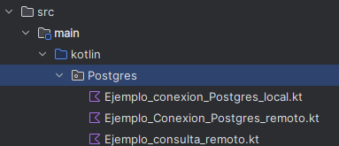

# Operaciones CRUD con PostgreSQL

!!!Tip "Kotlin - Instrucciones"
    Dentro del paquete `Postgres` del proyecto `BDRelacionales`, incluiremos los ejemplos de este apartado. Estos ejemplos mostrarán cómo gestionar datos desde una aplicación Kotlin conectada a la base de datos **`geo`**, utilizando las tablas `institut`, `poblacio` y `comarca`.

    


Antes de ejecutar los ejemplos, configura y comprueba el objeto `DatabaseLocal` siguiendo la [conexión a PostgreSQL desde Kotlin](Conectores_PostgreSQL.md#conexion-postgresql).

La conexión común se definirá una sola vez en `Postgres/DatabaseLocal.kt` y será reutilizada por todos los ejemplos PostgreSQL.

Una vez conectados a la BD, ya podemos hacer operaciones CRUD sobre ella, utilizando el objeto de conexión correspondiente.

**Read (SELECT)**{.verde}     

**Ejemplo_Select.kt**: Consulta todos los institutos

```kotlin
            package Postgres
            fun main(args: Array<String>) {
            val sql = "SELECT * FROM institut"

            DatabaseLocal.getConnection().use { conn -> // (1)!
                    conn.prepareStatement(sql).use { stmt ->
                    stmt.executeQuery().use { rs -> // (2)!

                        while (rs.next()) {
                            print("" + rs.getString(1) + "\t") // (3)!
                            println(rs.getString(2))
                        }
                    }
                }
                }
             }


```

1. El ejemplo obtiene la conexión centralizada definida en `DatabaseLocal`.
2. Una consulta de lectura se ejecuta con `executeQuery()` y devuelve un `ResultSet`.
3. También es posible leer columnas por posición, aunque usar su nombre suele resultar más claro y resistente a cambios de orden.

---

**Create (INSERT)**{.verde}  


**Ejemplo_Insert.kt**: inserta un instituto de prueba.

```kotlin
        package Postgres
        fun main(args: Array<String>) {

            val sql ="INSERT INTO institut (codi,nom,adreca,numero,codpostal,cod_m) VALUES(?,?,?,?,?,?)"

            DatabaseLocal.getConnection().use { conn ->

                conn.prepareStatement(sql).use { stmt ->
                    stmt.setString(1, "00000000")
                    stmt.setString(2, "IES PRUEBA")
                    stmt.setString(3, "CASTELLÓN")
                    stmt.setString(4, "S/N")
                    stmt.setInt(5, 12560)
                    stmt.setInt(6, 12040)
                    stmt.executeUpdate()
                }
                println("Instituto insertado")
            }
        }


```

**Update (UPDATE)**{.verde}    


**Ejemplo_Update.kt**: actualiza el campo nombre del instituto de prueba insertado.

```kotlin
        package Postgres
        fun main() {
            val sql = "UPDATE institut SET nom = ? WHERE codi = ?"

            DatabaseLocal.getConnection().use { conn ->

                conn.prepareStatement(sql).use { stmt ->
                    stmt.setString(1, "IES PRUEBA 2")
                    stmt.setString(2, "00000000")
                    stmt.executeUpdate()
                }
                println("Instituto modificado")
            }
        }


```

**Delete (DELETE)**{.verde}   
 

**Ejemplo_Delete.kt**: elimina el instituto de prueba insertado anteriormente.

```kotlin
        package Postgres
        fun main() {
            val sql = "DELETE FROM institut WHERE codi = ?"

            DatabaseLocal.getConnection().use { conn ->

                conn.prepareStatement(sql).use { stmt ->
                    stmt.setString(1, "00000000")
                    stmt.executeUpdate()
                }
                println("Instituto eliminado")
            }
        }


```


