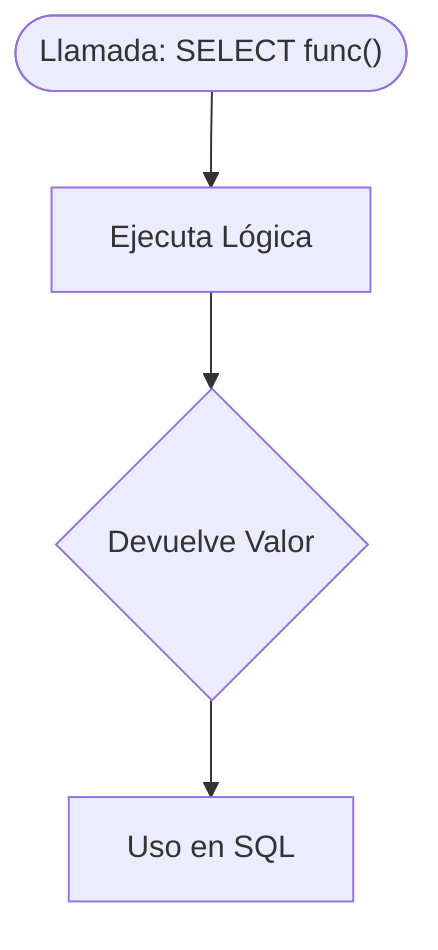
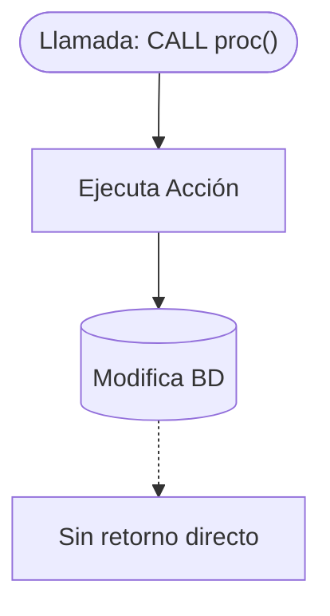

# Funciones y Procedimientos almacenados 

Tanto **las funciones** como **los procedimientos almacenados** son bloques de código que se guardan en el servidor de la base de datos y que encapsulan una serie de instrucciones SQL.

Se usan para:

- Reutilizar operaciones complejas
- Organizar mejor la lógica de negocio
- Mejorar el rendimiento (menos tráfico entre app y BD)
- Mantener la integridad de datos

**Diferencia entre Funciones y Procedimientos**{.azul}

Una **función** está diseñada para **calcular y devolver un resultado**. Se puede usar directamente dentro de una consulta SQL como parte de un SELECT, WHERE, ORDER BY, etc. Las funciones siempre devuelven un valor, que puede ser escalar (un número, texto...), una fila o una tabla.

Un **procedimiento** sirve para **ejecutar acciones** dentro de la base de datos, como insertar registros, modificar datos o gestionar operaciones en bloque. **No devuelve un valor directamente** (aunque puede usar parámetros de salida), y se ejecuta con CALL, no con SELECT.

**Función**

**Procedimiento**

!!!Note "Nota"
    **SQLite** no soporta funciones ni procedimientos almacenados como lo hacen bases de datos como PostgreSQL, MySQL u Oracle. Sin embargo, puedes simular su comportamiento mediante funciones definidas en la aplicación, o vistas y triggers.

Las funciones (FUNCTION) y los procedimientos (PROCEDURE) **no se crean desde el lenguaje Kotlin**, ya que son elementos propios del sistema gestor de bases de datos (SGBD), en este caso **PostgreSQL**. Para definirlos, se utiliza **SQL** y se ejecutan **directamente sobre la base de datos** a través de un cliente SQL.

Una vez que las funciones o procedimientos están creados en la base de datos, se pueden **utilizar perfectamente desde Kotlin** a través de **JDBC**, igual que se hace con cualquier consulta SQL:

- Las funciones se invocan con **SELECT nombre_funcion(...)**
- Los procedimientos se llaman con **CALL nombre_procedimiento(...)**

Y desde Kotlin, se gestionan mediante objetos como **PreparedStatement** y **CallableStatement**.

!!!question "🤔 Comprueba tu comprensión"

    Si te piden crear una funcionalidad para subir un 10% el sueldo a todos los empleados de un departamento, y otra para calcular cuál es el sueldo medio actual de dicho departamento, ¿qué usarías en cada caso?

    ??? success "Ver respuesta"
        - Para **subir el sueldo**, usarías un **Procedimiento Almacenado** (se llama con `CALL`), ya que su objetivo principal es ejecutar una acción que modifica los datos en la base de datos (un bloque de actualizaciones).
        - Para **calcular el sueldo medio**, usarías una **Función** (se llama con `SELECT`), ya que su objetivo es realizar un cálculo y devolver un valor o resultado que la aplicación necesita leer.

## 🔹Funciones (FUNCTION)

Una función en PostgreSQL es un bloque que:

- Puede aceptar parámetros
- Devuelve siempre un valor (escalar, tabla o compuesto)
- Se puede usar en consultas SQL (SELECT, WHERE, etc.)
- Puede tener IN, OUT, INOUT

!!!Warning "Sintaxis básica en PostgreSql"
        CREATE [OR REPLACE] FUNCTION nombre_funcion(parámetros)
        RETURNS tipo_de_dato
        LANGUAGE plpgsql
        AS $$
        BEGIN
            -- instrucciones
            RETURN valor;
        END;
        $$;

| Tipo de retorno                | ¿Qué devuelve?                                        | Ejemplo de uso                                           |
|-------------------------------|--------------------------------------------------------|-----------------------------------------------------------|
| `INTEGER`, `TEXT`, etc.       | Un único valor escalar                                | `RETURNS INTEGER` `RETURN x * x;`                      |
| `TABLE(...)`                  | Una tabla (varias columnas y filas)                   | `RETURNS TABLE(codi TEXT, nom TEXT)` `RETURN QUERY ...`|
| `SETOF INTEGER`               | Un conjunto de valores escalares                      | `RETURNS SETOF INTEGER` `RETURN NEXT i;`              |
| `SETOF RECORD`                | Muchas filas con estructura dinámica                  | `RETURNS SETOF RECORD`                                    |
| `%ROWTYPE`                    | Una fila con la estructura de una tabla existente     | `RETURNS institut%ROWTYPE` `SELECT * INTO reg ...`    |
| `RECORD`                      | Una sola fila con columnas genéricas                  | `RETURNS RECORD` `SELECT ... INTO resultado;`         |
| Tipo personalizado            | Una estructura definida con `CREATE TYPE`             | `RETURNS tipo_personalizado`                             |

!!!Tip ""   
    Los siguientes ejemplos  se han creado utilizando el cliente **SQL DBeaver** y la BD **Geo_docker**.

**Funciones que devuelve un valor**{.azul}:

**Ejemplo en SQL:**{.verde} Función que devuelve el cuadrado de un número.

    CREATE OR REPLACE FUNCTION cuadrado(x INTEGER)
    RETURNS INTEGER
    AS $$
    BEGIN
        RETURN x * x;
    END;
    $$ LANGUAGE plpgsql;

La llamada desde **SQL** sería:

    SELECT cuadrado(5);  --Devuelve 25

**En Kotlin**{.verde} la llamda a la función sería:

**Ejemplo_cuadrado.kt**

       fun main() {

            DatabaseLocal.getConnection().use { conn ->
                val sql = "SELECT cuadrado(?)"

                conn.prepareStatement(sql).use { stmt ->
                    stmt.setInt(1, 6) // por ejemplo: x = 6
                    val rs = stmt.executeQuery()

                    if (rs.next()) {
                        val resultado = rs.getInt(1)
                        println("El cuadrado de 6 es: $resultado")
                    }
                }
            }
        }

**Fucniones que devuelven una tabla**{.azul}

**Ejemplo en SQL:**{.verde} Función que devuelve todos los institutos junto con su población y comarca.

        CREATE OR REPLACE FUNCTION obtener_instituts()
        RETURNS TABLE (
            codi TEXT,
            nom TEXT,
            municipi TEXT,
            comarca TEXT
        )
        AS $$
            SELECT 
                i.codi,
                i.nom,
                p.nom AS municipi,
                c.nom_c AS comarca
            FROM institut i
            JOIN poblacio p ON i.cod_m = p.cod_m
            JOIN comarca c ON p.nom_c = c.nom_c
            ORDER BY comarca, municipi;
        $$ LANGUAGE sql;

La llamada desde **SQL** sería:

        SELECT * FROM obtener_instituts();

**En Kotlin**{.verde} la llamda a la función sería:

**Ejemplo_fun_obtener_institutos.kt**

        fun main() {

           DatabaseLocal.getConnection().use { conn ->
                val sql = "SELECT * FROM obtener_instituts()"

                conn.prepareStatement(sql).use { stmt ->
                    val rs = stmt.executeQuery()
                    while (rs.next()) {
                        val codi = rs.getString("codi")
                        val nom = rs.getString("nom")
                        val municipi = rs.getString("municipi")
                        val comarca = rs.getString("comarca")

                        println("Institut: $codi - $nom ($municipi, $comarca)")
                    }
                }
            }
        }

**Fucniones que aceptan filtros como parámetros**{.azul}

**Ejemplo en SQL:**{.verde} Función que devuelve los institutos de una comarca.

        CREATE OR REPLACE FUNCTION instituts_de_comarca(p_nom_c TEXT)
        RETURNS TABLE (
            codi TEXT,
            nom TEXT,
            municipi TEXT,
            comarca TEXT
        )
        AS $$
            SELECT 
                i.codi,
                i.nom,
                p.nom AS municipi,
                c.nom_c AS comarca
            FROM institut i
            JOIN poblacio p ON i.cod_m = p.cod_m
            JOIN comarca c ON p.nom_c = c.nom_c
            WHERE c.nom_c = p_nom_c
            ORDER BY municipi;
        $$ LANGUAGE sql;

La llamada desde **SQL** sería:

    
        SELECT * FROM instituts_de_comarca('Plana Baixa');

**En Kotlin**{.verde} la llamda a la función sería:
      
**Ejemplo_fun_instituts_de_comarca.kt**

        fun main() {

            DatabaseLocal.getConnection().use { conn ->
                val sql = "SELECT * FROM instituts_de_comarca(?)"

                conn.prepareStatement(sql).use { stmt ->
                    stmt.setString(1, "Plana Baixa") // Parámetro de entrada
                    val rs = stmt.executeQuery()
                    while (rs.next()) {
                        val codi = rs.getString("codi")
                        val nom = rs.getString("nom")
                        val municipi = rs.getString("municipi")
                        val comarca = rs.getString("comarca")

                        println("Institut: $codi - $nom ($municipi, $comarca)")
                    }
                }
            }
        }

## 🔹Procedimientos (PROCEDURE)

Los procedimientos no devuelven valores directamente, a diferencia de las funciones, pero pueden tener parámetros de entrada (IN), salida (OUT) o ambos (INOUT). Se utilizan para realizar tareas como:

- Inserciones o actualizaciones complejas
- Validaciones
- Operaciones en bloque
- Ejecución de lógica con control de flujo
- Agrupación de instrucciones dentro de una transacción

!!!Warning "Sintaxis básica en PostgreSql"
        CREATE [OR REPLACE] PROCEDURE nombre_procedimiento(
            [parámetro1 tipo [IN|OUT|INOUT]],
            ...
        )
        AS $$
        BEGIN
            -- cuerpo del procedimiento
        END;
        $$ LANGUAGE plpgsql;

**Ejemplo en SQL:**{.verde} Procedimiento que inserta un nuevo instituto y muestra un aviso.

        CREATE OR REPLACE PROCEDURE insertar_institut_resultado(
            IN p_codi VARCHAR,
            IN p_nom VARCHAR,
            IN p_cod_m INTEGER,
            OUT resultado TEXT
        )
        AS $$
        BEGIN
            -- ¿Municipio existe?
            IF NOT EXISTS (SELECT 1 FROM poblacio WHERE cod_m = p_cod_m) THEN
                resultado := 'MUNICIPIO_NO_ENCONTRADO';
                RETURN;
            END IF;

            -- ¿Instituto ya existe?
            IF EXISTS (SELECT 1 FROM institut WHERE codi = p_codi) THEN
                resultado := 'EXISTENTE';
                RETURN;
            END IF;

            -- Insertar instituto
            INSERT INTO institut (codi, nom, cod_m)
            VALUES (p_codi, p_nom, p_cod_m);

            resultado := 'INSERTADO';
        END;
        $$ LANGUAGE plpgsql;

La llamada desde **SQL** sería:

        CALL insertar_institut_resultado('I999', 'Institut Experimental', 12028, NULL);

**En Kotlin**{.verde} la llamda a la función sería:
      
**Ejemplo_pro_insertar_institut_resultado.kt**

        import java.sql.Types

        fun main() {
           DatabaseLocal.getConnection().use { conn ->
                val sql = "Call insertar_institut_resultado(?, ?, ?, ?)"

                conn.prepareCall(sql).use { stmt ->
                    stmt.setString(1, "I999")
                    stmt.setString(2, "Institut Experimental")
                    stmt.setInt(3, 12028)
                    stmt.registerOutParameter(4, Types.VARCHAR)

                    stmt.execute()

                    val resultado = stmt.getString(4)
                    println("Resultado: $resultado")
                }
            }
        }

## 📊 Resumen diferencias entre función y procedimiento en PostgreSQL

| Característica                    | FUNCIÓN (`FUNCTION`)                             | PROCEDIMIENTO (`PROCEDURE`)                        |
|----------------------------------|--------------------------------------------------|----------------------------------------------------|
| 🔁 Devuelve un valor             | ✅ Sí (con `RETURN`)                             | ❌ No directamente                                 |
| 📥 Parámetros de entrada (`IN`)  | ✅ Sí                                             | ✅ Sí                                               |
| 📤 Parámetros de salida (`OUT`)  | ✅ Sí (como `OUT`, `INOUT`, o `RETURNS`)         | ✅ Sí (`OUT`, `INOUT`)                             |
| 📌 Se invoca con…                | `SELECT nombre_funcion(...)`                     | `CALL nombre_procedimiento(...)`                  |
| 📊 Usable en consultas SQL       | ✅ Sí (puede ir en `SELECT`, `WHERE`, etc.)      | ❌ No                                               |
| 🔄 Puede devolver tablas         | ✅ Sí (`RETURNS TABLE` o `SETOF`)                | ❌ No directamente                                 |
| 🔁 Puede usar `RETURN`           | ✅ Obligatorio                                   | ❌ No se usa `RETURN`, sino solo `CALL`            |
| 🧱 Uso típico                    | Cálculos, validaciones, funciones reutilizables | Procesos complejos, lógica de negocio, transacciones |
