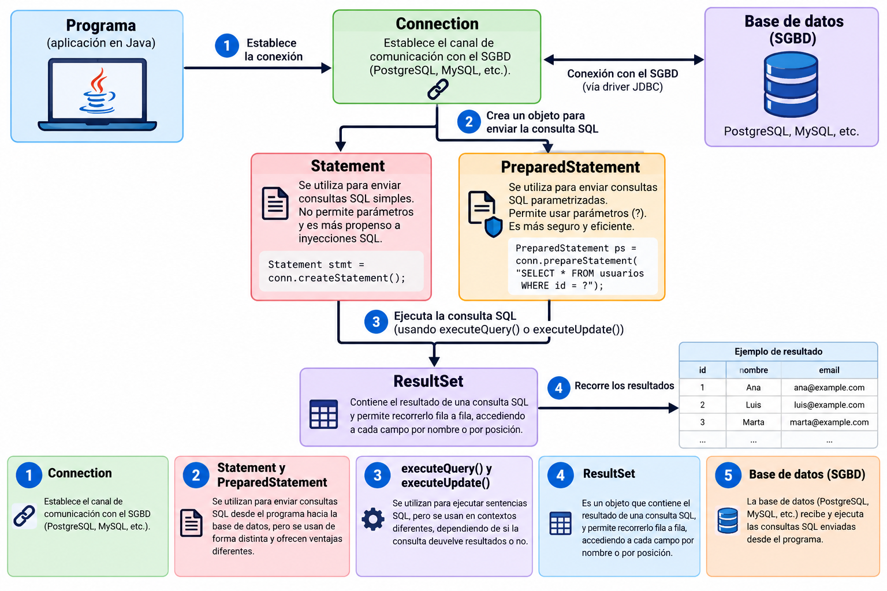

# Peticiones a la BD

En **JDBC** (Java Database Connectivity), las operaciones sobre la base de datos se realizan  utilizando los siguientes objetos y métodos:




- **Connection**, como ya se explicó en el apartado anterior, establece el canal de comunicación con el SGBD (PostgreSQL, MySQL, etc.)

- Los objetos **PreparedStatement** y **Statement** se utilizan para enviar consultas SQL desde el programa hacia la base de datos, pero se usan de forma distinta y ofrecen ventajas diferentes, que se explican más adelante, en este apartado.

- **ResultSet** es un objeto que contiene el resultado de una consulta SQL, y permite recorrer fila a fila el conjunto de resultados, accediendo a cada campo por nombre o por posición.

- Los métodos **executeQuery()** y **executeUpdate()** se utilizan para ejecutar sentencias SQL, pero se usan en contextos diferentes, dependiendo de si la consulta devuelve resultados o no.


## ExecuteQuery/ExecuteUpdate

Cuando una aplicación se conecta a una base de datos, necesita ejecutar sentencias SQL desde el código. En JDBC (Java/Kotlin), existen dos métodos principales para ello: **executeQuery()** y **executeUpdate()**. Ambos se invocan desde un objeto **Statement** o **PreparedStatement**.


Método|	Uso principal|	Tipo de sentencia SQL|	Resultado que devuelve
------|--------------|-----------------------|------------------------
**executeQuery()**|	Realizar consultas|	SELECT|	Objeto ResultSet con los datos consultados
**executeUpdate()**|Realizar modificaciones|	INSERT, UPDATE, DELETE, DDL (CREATE, DROP, etc.)|	Un entero con el número de filas afectadas
**execute()**|Cuando no se sabe de antemano el tipo de sentencia|SELECT, INSERT, UPDATE, DELETE, DDL|Un booleano: `true` si devuelve un ResultSet, `false` si devuelve un entero


## PreparedStatement/Statement

Aunque ambos objetos permiten enviar sentencias SQL a la base de datos, la elección entre uno u otro depende del tipo de consulta y de si intervienen datos externos (por ejemplo, introducidos por el usuario). La siguiente tabla resume qué componente conviene usar en cada situación:

| Si necesitas...                                     | Usa...            |
|-----------------------------------------------------|-------------------|
| Consultas sencillas sin parámetros                  | `Statement` |
| Consultas con datos del usuario                     | `PreparedStatement` |
| Seguridad frente a inyecciones SQL                  | `PreparedStatement` |
| Ejecutar muchas veces con distintos valores         | `PreparedStatement` |
| Crear tablas o sentencias SQL fijas                 | `Statement` |

### Diferencia en la compilación entre Statement y PreparedStatement

Statement y PreparedStatement son interfaces de JDBC cuyos objetos permiten preparar y ejecutar sentencias SQL.

Cada vez que envías una sentencia SQL al motor de base de datos, el motor debe hacer varios pasos:

- Parsear la consulta → comprobar que la sintaxis SQL es correcta.
- Compilar → convertir la consulta en un plan de ejecución interno (cómo buscar los datos, qué índices usar, etc.).
- Ejecutar → obtener los resultados.

🔹 **Con Statement**

Cada vez que llamas a executeQuery() o executeUpdate(), el SQL completo se envía como texto:

```kotlin
    var stmt = conn.createStatement() // (1)!

    stmt.executeQuery("SELECT * FROM clientes WHERE ciudad = 'Valencia'") // (2)!
    stmt.executeQuery("SELECT * FROM clientes WHERE ciudad = 'Madrid'")

    stmt.close() // (4)!
```

<!--
// Modifica la ciudad de un cliente
    val modificados = stmt.executeUpdate("UPDATE clientes SET ciudad = 'Madrid' WHERE id = 1") // (3)!

    // Elimina los clientes de Valencia
    val eliminados = stmt.executeUpdate("DELETE FROM clientes WHERE ciudad = 'Valencia'")
-->

1. Crea un `Statement` a partir de la conexión, sin ningún SQL asociado todavía.
2. Cada llamada envía el SQL completo como texto: el motor lo parsea y compila de nuevo en cada ejecución.
3. `executeUpdate()` se usa con sentencias que modifican datos (`UPDATE`, `DELETE`...) y devuelve el número de filas afectadas.
4. Cierra el `Statement` y libera los recursos asociados.

En este caso, el motor parsea y compila de nuevo las dos consultas, aunque solo cambia el valor de 'Valencia' a 'Madrid'.

🔁 Es decir, se repite todo el trabajo de compilación cada vez, lo que reduce el rendimiento si haces muchas consultas parecidas.


🔹 **Con PrepareStatement**

Aquí, el SQL se envía una sola vez con parámetros (?):

```kotlin
    var pstmt = conn.prepareStatement("SELECT * FROM clientes WHERE ciudad = ?") // (1)!
    pstmt.setString(1, "Valencia") // (2)!
    pstmt.executeQuery()

    pstmt.setString(1, "Madrid")
    pstmt.executeQuery()
    pstmt.close()

    
```
<!--
// Modifica la ciudad de un cliente
    pstmt = conn.prepareStatement("UPDATE clientes SET ciudad = ? WHERE id = ?")
    pstmt.setString(1, "Madrid")
    pstmt.setInt(2, 1) // (3)!
    val modificados = pstmt.executeUpdate()
    pstmt.close()

    // Elimina los clientes de Valencia
    pstmt = conn.prepareStatement("DELETE FROM clientes WHERE ciudad = ?")
    pstmt.setString(1, "Valencia")
    val eliminados = pstmt.executeUpdate()
    pstmt.close()
-->

1. El SQL se compila una sola vez, con `?` como marcador de posición para cada parámetro.
2. `setString()` asigna el valor según la posición del parámetro (empezando en 1); el mismo `PreparedStatement` se reutiliza cambiando solo el valor.
3. Cuando hay varios parámetros, cada `?` se corresponde con su posición: el primero para la ciudad y el segundo para el id.

El motor solo compila la consulta una vez, y después reutiliza el mismo plan de ejecución cambiando solo el valor del parámetro.

⚡ Esto ahorra tiempo y recursos, sobre todo cuando repites muchas veces la misma consulta con diferentes datos (por ejemplo, en bucles o inserciones masivas).    

<!--
!!! Tip "`PreparedStatement` y `prepareStatement()` no son lo mismo"
    **`PreparedStatement`** es la clase o tipo de objeto JDBC que representa una sentencia SQL preparada.

    **`prepareStatement(sql)`** es el método de `Connection` que crea y devuelve un objeto de tipo `PreparedStatement`.

    ```kotlin
    val stmt: PreparedStatement = conn.prepareStatement(sql)
    ```
-->
!!!question "🤔 Comprueba tu comprensión"
    ¿Por qué es especialmente importante usar `PreparedStatement` cuando trabajamos con datos introducidos por el usuario (por ejemplo, desde un formulario)?

    ??? success "Ver respuesta"
        Principalmente por **seguridad**, para evitar ataques de **Inyección SQL**. Al usar `PreparedStatement`, los datos introducidos por el usuario se tratan estrictamente como valores literales y nunca como código ejecutable. Además, mejora el rendimiento al compilar la consulta una sola vez.


Continúa con las [operaciones con SQLite](Operaciones.md).
