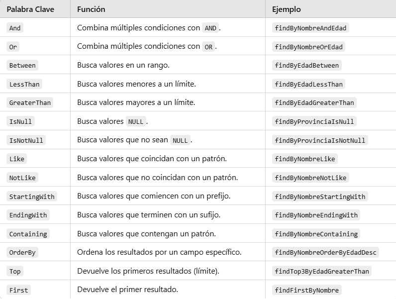

# Consultas con Spring Data JPA

En la primera aplicación utilizamos `findAll()` para recuperar todas las comarcas. Este método ya está disponible porque nuestro repositorio hereda de `JpaRepository`: no necesitamos declararlo ni escribir su consulta.

Ahora queremos **buscar solo las comarcas de una provincia**. Para definir esta consulta veremos dos alternativas: utilizar el nombre del método o escribir la consulta con `@Query`. Seguiremos trabajando en **`ComarcaRepository.kt`**, dentro del paquete `repository`.

## Consultas por el nombre del método

Spring Data JPA interpreta el nombre de los métodos del repositorio para construir la consulta. Son las **consultas derivadas**: declaramos qué queremos buscar y Spring Data JPA proporciona la implementación.

### Cómo se construye el nombre

El nombre **no se elige libremente**: combina palabras reconocidas por Spring Data JPA con los nombres de las propiedades de nuestra entidad. Para las búsquedas que veremos, podemos utilizar este esquema:

```text
findBy + Propiedad + Operador opcional
       + otras condiciones opcionales
       + ordenación opcional
```

| Parte | Para qué sirve | Ejemplo |
|---|---|---|
| `findBy` | Inicia una búsqueda; después de `By` aparecen los criterios. | `findByProvincia` |
| Propiedad | Indica qué propiedad de la entidad se consulta. Se escribe con inicial mayúscula dentro del método. | `provincia` → `Provincia`; `nomC` → `NomC` |
| Operador | Indica cómo comparar. Si se omite, se busca por igualdad. | `NomCContaining` busca nombres que contengan un texto. |
| `And` o `Or` | Une dos condiciones. Después se escribe la siguiente propiedad y, si procede, su operador. | `ProvinciaAndNomCContaining` |
| `OrderBy` + propiedad + `Asc` o `Desc` | Ordena los resultados. No añade un filtro ni necesita otro argumento. | `OrderByNomCAsc` |

No se escriben espacios ni los signos `+`: el nombre final es una sola palabra compuesta, como `findByProvinciaOrderByNomCAsc`.

Por ejemplo:

```text
findByProvincia
│     └─ Provincia: propiedad por la que filtramos
└─────── findBy: buscar por un criterio
```

Esto significa **«buscar comarcas cuya provincia sea igual al valor recibido»**. No significa buscar una tabla llamada `Provincia`: la entidad consultada ya viene indicada en `JpaRepository<Comarca, String>`.

### Declarar el método y pasarle un valor

En la primera aplicación ya dejamos declarado este método:

```kotlin
package org.example.springjpa.repository

import org.example.springjpa.model.Comarca
import org.springframework.data.jpa.repository.JpaRepository

interface ComarcaRepository : JpaRepository<Comarca, String> {
    fun findByProvincia(provincia: String): List<Comarca> // (1)!
}
```

1. `findBy` indica una búsqueda y `Provincia` hace referencia a la propiedad `provincia` de la entidad. El argumento contiene el valor que buscamos. Devuelve una lista vacía si no hay coincidencias.

No añadas otra declaración si el método ya existe. Tampoco necesitas escribir su cuerpo ni crear una clase que implemente el repositorio.

Desde un controlador que tenga inyectado el repositorio, podríamos llamarlo así:

```kotlin
val comarcas = comarcaRepository.findByProvincia("Alacant") // (1)!
```

1. Recupera las comarcas cuya provincia es `Alacant`. Esta línea va dentro de un método del controlador; no se añade a la interfaz del repositorio.

La búsqueda equivale a esta consulta SQL, aunque el SQL concreto que genera Hibernate puede tener otros alias o formato:

```sql
SELECT nom_c, provincia
FROM comarca
WHERE provincia = 'Alacant';
```

!!! warning "Propiedades Kotlin, no columnas SQL"
    Los nombres de los métodos se construyen con las propiedades de la entidad. Por ejemplo, utilizaremos `NomC` para referirnos a la propiedad `nomC`, no `nom_c`, que es el nombre de la columna. Si una propiedad no existe, Spring Data JPA no podrá crear la consulta y puede impedir el arranque de la aplicación.

El **nombre del parámetro Kotlin** no determina el filtro. En `fun findByProvincia(valor: String)`, se seguiría filtrando por `provincia`, porque eso lo indica el nombre del método. Usamos `provincia` también como nombre del parámetro para que el código sea más claro. El valor concreto, como `"Alacant"`, se pasa al llamar al método; no forma parte de su nombre.

## Combinar condiciones

Vamos a leer un nombre más largo por partes. Este método buscaría las comarcas de una provincia cuyo nombre contenga un texto:

```kotlin
fun findByProvinciaAndNomCContaining(
    provincia: String,
    texto: String
): List<Comarca> // (1)!
```

1. `Provincia` compara por igualdad con el primer argumento. `And` exige que se cumplan las dos condiciones. `NomCContaining` comprueba que `nomC` contiene el segundo argumento.

```text
findBy | Provincia | And | NomC | Containing
buscar | provincia | y   | nombre que contenga un texto
```

Una llamada desde el controlador sería:

```kotlin
val comarcas = comarcaRepository.findByProvinciaAndNomCContaining("Alacant", "Marina")
```

Su significado SQL es:

```sql
SELECT nom_c, provincia
FROM comarca
WHERE provincia = 'Alacant' AND nom_c LIKE '%Marina%';
```

Para probarlo, añade su declaración dentro de `ComarcaRepository` antes de llamarlo. Es un ejemplo para comprender la convención; **no es necesario añadirlo para continuar con el listado del tema**.

Si cambiamos `And` por `Or`, bastará con que se cumpla una de las condiciones. Los argumentos se asignan siguiendo el orden de las condiciones del nombre: en este caso, primero la provincia y después el texto del nombre.

## Añadir ordenación

Podemos ampliar el nombre del método para ordenar el resultado. Añade este método **dentro de la misma interfaz `ComarcaRepository`**, junto al anterior:

```kotlin
fun findByProvinciaOrderByNomCAsc(provincia: String): List<Comarca> // (1)!
```

1. `findByProvincia` filtra por provincia; `OrderByNomC` ordena por la propiedad `nomC`; `Asc` indica orden ascendente. Para ordenar en sentido descendente se utiliza `Desc`.

```text
findBy | Provincia | OrderBy | NomC | Asc
buscar | filtro    | ordenar | nombre | ascendente
```

Solo recibe un argumento porque únicamente hay **un filtro**, por provincia. `NomC` aparece después de `OrderBy`, por lo que indica cómo ordenar, no un segundo valor que debamos pasar.

Por ejemplo, dentro de un método del controlador:

```kotlin
val comarcas = comarcaRepository.findByProvinciaOrderByNomCAsc("Alacant")
```

El resultado equivale a:

```sql
SELECT nom_c, provincia
FROM comarca
WHERE provincia = 'Alacant'
ORDER BY nom_c ASC;
```

## Palabras clave habituales

| Palabra | Significado | Ejemplo de método en `ComarcaRepository` | Argumentos |
|---|---|---|---|
| Sin operador | Igual a | `findByProvincia` | Una provincia |
| `Containing` | Contiene un texto | `findByNomCContaining` | Un texto |
| `StartingWith` | Empieza por un texto | `findByNomCStartingWith` | Un texto |
| `IgnoreCase` | Compara sin distinguir mayúsculas y minúsculas | `findByProvinciaIgnoreCase` | Una provincia |
| `IsNull` | No tiene valor | `findByProvinciaIsNull` | Ninguno |
| `And` | Deben cumplirse ambas condiciones | `findByProvinciaAndNomC` | Provincia y nombre, en ese orden |
| `Or` | Debe cumplirse al menos una condición | `findByProvinciaOrNomC` | Provincia y nombre, en ese orden |

Estos nombres son ejemplos de consulta, no métodos que debas añadir todos al proyecto. Operadores como `GreaterThan`, `LessThan` o `Between` permiten comparar números o fechas; se utilizan con propiedades cuyos tipos admitan esas comparaciones.

??? note "Referencia ampliada de palabras clave"
    Existen otros prefijos de búsqueda, como `readBy`, `getBy` y `queryBy`. Para mantener los ejemplos uniformes utilizaremos `findBy`.

    No es necesario memorizarlas todas. Consulta esta referencia cuando necesites construir otras búsquedas:

    

### Errores que debes evitar

- Escribir `findByNombre` si la entidad tiene una propiedad `nomC`, no `nombre`.
- Utilizar `findByNom_c` pensando en la columna SQL: en esta entidad corresponde `findByNomC`.
- Escribir `buscarPorProvincia` esperando que Spring traduzca libremente el nombre: los métodos derivados deben seguir las palabras clave reconocidas.
- Olvidar el segundo argumento de un método con dos comparaciones, como `findByProvinciaAndNomC`.
- Añadir un argumento para `IsNull` o para `OrderBy`: no reciben un valor de comparación.

En las relaciones también se pueden encadenar propiedades, como `PoblacioComarcaProvincia`. Lo explicaremos cuando estén definidas las entidades relacionadas; por ahora basta con dominar los nombres de las propiedades de `Comarca`.

## Consultas con @Query y JPQL

Cuando un nombre de método resulta demasiado largo o queremos expresar la consulta explícitamente, podemos utilizar **`@Query`**. No significa que la consulta vaya a ser más rápida: es otra forma de definirla.

En los ejemplos de este tema, `@Query` contiene **JPQL** (Java Persistence Query Language). Se parece a SQL, pero trabaja con **entidades y propiedades de Kotlin**, en lugar de tablas y columnas.

| En SQL | En JPQL |
|---|---|
| Tabla `comarca` | Entidad `Comarca` |
| Columna `nom_c` | Propiedad `nomC` |
| Seleccionar columnas | Seleccionar la entidad, como en `SELECT c` |

Vamos a expresar **la misma búsqueda por provincia** utilizando JPQL:

```kotlin
package org.example.springjpa.repository

import org.example.springjpa.model.Comarca
import org.springframework.data.jpa.repository.JpaRepository
import org.springframework.data.jpa.repository.Query
import org.springframework.data.repository.query.Param

interface ComarcaRepository : JpaRepository<Comarca, String> {
    @Query("SELECT c FROM Comarca c WHERE c.provincia = :provincia") // (1)!
    fun findByProvincia(@Param("provincia") provincia: String): List<Comarca> // (2)!

    fun findByProvinciaOrderByNomCAsc(provincia: String): List<Comarca>
}
```

1. `Comarca` es el nombre de la entidad y `c` es su alias. `SELECT c` recupera entidades completas. `c.provincia` es una propiedad y `:provincia` es el parámetro cuyo valor recibirá la consulta.
2. `@Param("provincia")` vincula el argumento Kotlin con `:provincia`. Al utilizar `@Query`, la consulta se toma de la anotación, no se deriva del nombre del método.

!!! warning "Son alternativas, no métodos duplicados"
    Elige una de las dos versiones de `findByProvincia`: la derivada o la anotada con `@Query`. Si pruebas esta segunda versión, sustituye la declaración anterior y añade los imports necesarios. No declares dos métodos con el mismo nombre y los mismos parámetros.

La llamada desde el controlador no cambia:

```kotlin
val comarcas = comarcaRepository.findByProvincia("Alacant")
```

En ambos casos, el resultado es una lista de entidades `Comarca`. Hibernate se encarga de traducir la consulta a SQL y recuperar los datos de PostgreSQL.

## Ejemplo completo para probar las consultas

Los siguientes archivos reúnen los ejemplos sobre `Comarca` de este apartado. No modifican la base de datos: todas las operaciones son consultas. Los ejemplos de relaciones se probarán en su apartado correspondiente.

### Repositorio completo

**Sustituye el contenido de `repository/ComarcaRepository.kt`** por este código. No crees otra interfaz con el mismo nombre. Se conservan los métodos que utilizan los demás ejemplos del tema.

```kotlin
package org.example.springjpa.repository

import org.example.springjpa.model.Comarca
import org.springframework.data.jpa.repository.JpaRepository
import org.springframework.data.jpa.repository.Query
import org.springframework.data.repository.query.Param

interface ComarcaRepository : JpaRepository<Comarca, String> {
    fun findByProvincia(provincia: String): List<Comarca>

    fun findByProvinciaAndNomCContaining(
        provincia: String,
        texto: String
    ): List<Comarca>

    fun findByProvinciaOrderByNomCAsc(provincia: String): List<Comarca>
    fun findByProvinciaOrderByNomCDesc(provincia: String): List<Comarca>

    fun findByNomCContaining(texto: String): List<Comarca>
    fun findByNomCStartingWith(texto: String): List<Comarca>
    fun findByProvinciaIgnoreCase(provincia: String): List<Comarca>
    fun findByProvinciaIsNull(): List<Comarca> // (1)!

    fun findByProvinciaAndNomC(provincia: String, nomC: String): List<Comarca>
    fun findByProvinciaOrNomC(provincia: String, nomC: String): List<Comarca>

    @Query("SELECT c FROM Comarca c WHERE c.provincia = :provincia")
    fun findComarcasporProvincia(@Param("provincia") provincia: String): List<Comarca> // (2)!
}
```

1. `IsNull` no recibe argumentos: busca registros cuya provincia no tiene valor.
2. `findComarcasporProvincia` utiliza la consulta escrita en `@Query`; no depende de la convención de nombres. Puede coexistir con `findByProvincia` porque tienen nombres distintos. Ambos filtran por provincia sin garantizar un orden; `findByProvinciaOrderByNomCAsc` añade la ordenación por nombre.

### Controlador de pruebas

Crea **`controller/ConsultasComarcaController.kt`**. Conserva el controlador de la primera aplicación: este utiliza la ruta **`/api/consultas-comarcas`**, por lo que no entra en conflicto con `/api/comarcas`.

```kotlin
package org.example.springjpa.controller

import org.example.springjpa.model.Comarca
import org.example.springjpa.repository.ComarcaRepository
import org.springframework.web.bind.annotation.*

@RestController
@RequestMapping("/api/consultas-comarcas") // (1)!
class ConsultasComarcaController(
    private val comarcaRepository: ComarcaRepository
) {
    @GetMapping
    fun todas(): List<Comarca> = comarcaRepository.findAll()

    @GetMapping("/provincia")
    fun porProvincia(@RequestParam provincia: String): List<Comarca> =
        comarcaRepository.findByProvincia(provincia)

    @GetMapping("/provincia-y-texto")
    fun porProvinciaYTexto(
        @RequestParam provincia: String,
        @RequestParam texto: String
    ): List<Comarca> =
        comarcaRepository.findByProvinciaAndNomCContaining(provincia, texto)

    @GetMapping("/orden-asc")
    fun ordenAsc(@RequestParam provincia: String): List<Comarca> =
        comarcaRepository.findByProvinciaOrderByNomCAsc(provincia)

    @GetMapping("/orden-desc")
    fun ordenDesc(@RequestParam provincia: String): List<Comarca> =
        comarcaRepository.findByProvinciaOrderByNomCDesc(provincia)

    @GetMapping("/contiene")
    fun contiene(@RequestParam texto: String): List<Comarca> =
        comarcaRepository.findByNomCContaining(texto)

    @GetMapping("/empieza")
    fun empieza(@RequestParam texto: String): List<Comarca> =
        comarcaRepository.findByNomCStartingWith(texto)

    @GetMapping("/sin-mayusculas")
    fun sinMayusculas(@RequestParam provincia: String): List<Comarca> =
        comarcaRepository.findByProvinciaIgnoreCase(provincia)

    @GetMapping("/sin-provincia")
    fun sinProvincia(): List<Comarca> =
        comarcaRepository.findByProvinciaIsNull()

    @GetMapping("/and")
    fun ambas(
        @RequestParam provincia: String,
        @RequestParam nomC: String
    ): List<Comarca> =
        comarcaRepository.findByProvinciaAndNomC(provincia, nomC)

    @GetMapping("/or")
    fun cualquiera(
        @RequestParam provincia: String,
        @RequestParam nomC: String
    ): List<Comarca> =
        comarcaRepository.findByProvinciaOrNomC(provincia, nomC)

    @GetMapping("/jpql")
    fun conJpql(@RequestParam provincia: String): List<Comarca> =
        comarcaRepository.findComarcasporProvincia(provincia) // (2)!
}
```

1. Es un controlador didáctico para probar consultas. Todavía devuelve entidades directamente, como en la primera aplicación; la separación mediante servicios y DTO se explica más adelante.
2. Los nombres de los métodos del controlador son libres. La convención de nombres se aplica a los métodos derivados del **repositorio**, no a los del controlador. Las URL se definen mediante las anotaciones de Spring Web.

### Probar desde el navegador

Arranca o reinicia la aplicación y abre los siguientes enlaces. También puedes enviarlos como peticiones **GET** desde Postman; no necesitan cuerpo JSON.

| Consulta | Enlace de prueba | Qué comprobar |
|---|---|---|
| Todas | [Listar](http://localhost:8080/api/consultas-comarcas) | Recupera todas las comarcas. |
| Igualdad | [Provincia Alacant](http://localhost:8080/api/consultas-comarcas/provincia?provincia=Alacant) | Todas tienen esa provincia. |
| Dos condiciones | [Provincia y texto](http://localhost:8080/api/consultas-comarcas/provincia-y-texto?provincia=Alacant&texto=Marina) | Se cumplen ambos filtros. |
| Orden ascendente | [Orden ascendente](http://localhost:8080/api/consultas-comarcas/orden-asc?provincia=Alacant) | Los nombres están ordenados según la ordenación de PostgreSQL. |
| Orden descendente | [Orden descendente](http://localhost:8080/api/consultas-comarcas/orden-desc?provincia=Alacant) | El orden se invierte respecto al anterior. |
| Contiene | [Contiene Marina](http://localhost:8080/api/consultas-comarcas/contiene?texto=Marina) | El nombre contiene ese texto. |
| Empieza por | [Empieza por Marina](http://localhost:8080/api/consultas-comarcas/empieza?texto=Marina) | El nombre empieza por ese texto. |
| Sin distinguir mayúsculas | [Provincia alacant](http://localhost:8080/api/consultas-comarcas/sin-mayusculas?provincia=alacant) | Encuentra también la provincia escrita como `Alacant`. |
| Valor nulo | [Sin provincia](http://localhost:8080/api/consultas-comarcas/sin-provincia) | Solo devuelve provincias nulas, no cadenas vacías. |
| AND | [Provincia y nombre](http://localhost:8080/api/consultas-comarcas/and?provincia=Alacant&nomC=Marina%20Alta) | Deben coincidir la provincia y el nombre exacto. |
| OR | [Provincia o nombre](http://localhost:8080/api/consultas-comarcas/or?provincia=Valencia&nomC=Marina%20Alta) | Basta con que coincida uno de los dos valores. |
| JPQL | [Consulta con JPQL](http://localhost:8080/api/consultas-comarcas/jpql?provincia=Alacant) | Devuelve las mismas comarcas que la búsqueda por igualdad, aunque sin orden garantizado. |

Los valores de los enlaces son ejemplos: comprueba los nombres existentes en tu base `geo` y cámbialos si es necesario. Una respuesta `[]` es correcta cuando no hay coincidencias; puede ocurrir especialmente al buscar provincias nulas.


## Qué utilizaremos ahora

Para las búsquedas sencillas de comarcas, la convención de nombres es suficiente. Utilizaremos `@Query` cuando ayude a expresar la consulta con mayor claridad.

Las consultas que recorren varias entidades se verán en [Relaciones de geo](relaciones.md), después de definir las relaciones entre comarcas, poblaciones e institutos. Por ahora no necesitas añadir esos métodos al proyecto.

En el siguiente apartado conectaremos la búsqueda por provincia con una página HTML, para introducir el filtro desde el navegador.

Referencia: [consultas con Spring Data JPA](https://docs.spring.io/spring-data/jpa/reference/jpa/query-methods.html).
