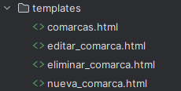
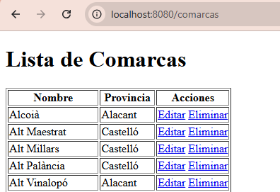
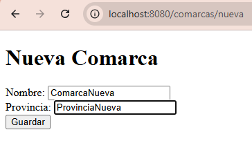
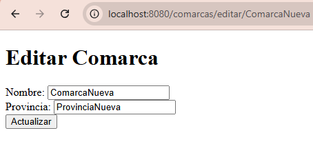
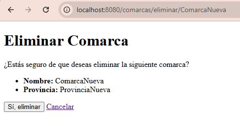

# Crear, editar y eliminar desde formularios

Ya sabemos mostrar y buscar comarcas. Ahora añadiremos formularios para **crear una comarca, modificar su provincia y eliminarla**. Estas operaciones completan el CRUD: crear, consultar, actualizar y borrar.

Trabajaremos solo con registros de prueba. Que PostgreSQL esté en nuestro equipo no significa que podamos modificar indiscriminadamente los datos de clase.

## Archivos que vamos a cambiar

- Sustituye el contenido de `controller/ComarcaMvcController.kt`; conserva el controlador REST.
- Crea `nueva_comarca.html`, `editar_comarca.html` y `eliminar_comarca.html` en `src/main/resources/templates`.
- Sustituye `comarcas.html` por el listado con búsqueda y enlaces a las operaciones.
- Conserva la entidad `Comarca` y el repositorio.

## Del formulario al repositorio

| Paso | Petición | Qué hace |
|---|---|---|
| Mostrar un formulario | GET | Prepara los datos y devuelve una plantilla. |
| Enviar el formulario | POST | Recibe los datos y modifica la base de datos. |
| Volver al listado | Redirección | El navegador hace un nuevo GET al listado. |

No borramos mediante enlaces GET: el enlace muestra la confirmación y el formulario POST realiza el borrado.

## Controlador MVC

En esta etapa didáctica el controlador llama directamente al repositorio. Sustituye el controlador MVC anterior por esta versión y añade las plantillas. Más adelante trasladaremos la lógica de negocio a servicios.

Archivo **`controller/ComarcaMvcController.kt`**. La clase mantiene el nombre `ComarcaControllerEntity` usado en el apartado anterior.

```kotlin
package org.example.springjpa.controller

import org.example.springjpa.model.Comarca
import org.springframework.stereotype.Controller
import org.springframework.ui.Model
import org.example.springjpa.repository.ComarcaRepository
import org.springframework.web.bind.annotation.*


@Controller // (1)!
@RequestMapping("/comarcas")
class ComarcaControllerEntity(private val comarcaRepository: ComarcaRepository) {
    @GetMapping
    fun listarComarcas(model:Model): String {
        val comarcas = comarcaRepository.findAll()
        model.addAttribute("comarcas", comarcas)
        return "comarcas" // Nombre de la plantilla HTML
    }

    @GetMapping("/buscar")
    fun buscarComarcasPorProvincia(@RequestParam provincia: String, model: Model): String {
        val comarcas= comarcaRepository.findByProvincia(provincia)
        model.addAttribute("comarcas", comarcas)
        return "comarcas" // Nombre de la plantilla HTML
    }

    @GetMapping("/nueva")
    fun mostrarFormularioNuevaComarca(model: Model): String {
        model.addAttribute("comarca", Comarca())
        return "nueva_comarca"
    }

    @PostMapping("/nueva")
    fun guardarComarca(@ModelAttribute comarca: Comarca): String { // (2)!
        require(comarca.nomC.isNotBlank()) { "El nombre es obligatorio" }
        require(!comarcaRepository.existsById(comarca.nomC)) { "La comarca ya existe" }
        comarcaRepository.save(comarca) // (3)!
        return "redirect:/comarcas" // (4)!
    }

    @GetMapping("/editar/{id}")
    fun mostrarFormularioEditarComarca(
        @PathVariable id: String,
        model: Model
    ): String {

        val comarca = comarcaRepository.findById(id)
            .orElseThrow { IllegalArgumentException("Comarca no encontrada: $id") }

        model.addAttribute("comarca", comarca)
        return "editar_comarca"
    }

    @PostMapping("/editar/{id}")
    fun actualizarComarca(
        @PathVariable id: String,
        @ModelAttribute comarca: Comarca
    ): String {

        val comarcaExistente = comarcaRepository.findById(id)
            .orElseThrow { IllegalArgumentException("Comarca no encontrada: $id") }

        // Solo se actualizan los campos editables
        comarcaExistente.provincia = comarca.provincia // (5)!

        comarcaRepository.save(comarcaExistente)

        return "redirect:/comarcas"
    }

    @GetMapping("/eliminar/{id}")
    fun confirmarEliminacion(@PathVariable id: String, model: Model): String {
        val comarca = comarcaRepository.findById(id)
            .orElseThrow { IllegalArgumentException("Comarca no encontrada: $id") }
        model.addAttribute("comarca", comarca)
        return "eliminar_comarca"
    }

    @PostMapping("/eliminar/{id}")
    fun eliminarComarca(@PathVariable id: String): String {
        if (!comarcaRepository.existsById(id)) {
            throw IllegalArgumentException("Comarca no encontrada: $id")
        }
        comarcaRepository.deleteById(id)
        return "redirect:/comarcas"
    }

}
```

1. Es un controlador de páginas HTML. Sus métodos devuelven nombres de plantillas o una redirección.
2. `@ModelAttribute` recoge los campos del formulario en un objeto `Comarca`. Las comprobaciones del servidor complementan los atributos HTML como `required`.
3. `save` sirve tanto para guardar nuevas entidades como para actualizar existentes. Por eso comprobamos antes que el código del alta no exista.
4. `redirect:` hace que el navegador vuelva al listado después del POST, evitando repetir el envío al recargar esa página.
5. Recuperamos la entidad existente y cambiamos solo la provincia. No confiamos en el identificador enviado en un campo del formulario: usamos el de la URL.

## Plantillas de los formularios

`th:object` selecciona el objeto del modelo y `th:field` vincula un campo HTML con una propiedad de ese objeto. Los formularios de este ejemplo modifican directamente una entidad sencilla; en los apartados siguientes separaremos los datos de entrada mediante DTO.



### Formulario de alta

Crea `templates/nueva_comarca.html`:

```html
<!DOCTYPE html>
<html xmlns:th="http://www.thymeleaf.org">
<head>
<meta charset="UTF-8">
<title>Nueva Comarca</title>
</head>
<body>

<h1>Nueva Comarca</h1>

<form th:action="@{/comarcas/nueva}" th:object="${comarca}" method="post"> <!-- (1)! -->

    <label for="nomC">Nombre:</label>
    <input type="text" th:field="*{nomC}" maxlength="50" required> <!-- (2)! -->
    <br>

    <label for="provincia">Provincia:</label>
    <input type="text" th:field="*{provincia}" maxlength="25" required>
    <br>

    <button type="submit">Guardar</button>

</form>

</body>
</html>
```

1. `th:object` usa el objeto vacío que añadió el controlador al modelo. El POST envía los campos a la operación de alta.
2. `th:field` genera el nombre y valor del campo a partir de la propiedad. `required` y `maxlength` ayudan en el navegador, pero las comprobaciones del servidor siguen siendo necesarias.

### Formulario de edición

Crea `templates/editar_comarca.html`:

```html
<!DOCTYPE html>
<html xmlns:th="http://www.thymeleaf.org">
<head>
    <meta charset="UTF-8">
    <title>Editar Comarca</title>
</head>
<body>

<h1>Editar Comarca</h1>

<form th:action="@{/comarcas/editar/{id}(id=${comarca.nomC})}"
    th:object="${comarca}"
    method="post">

    <label for="nomC">Nombre:</label>
    <input type="text" th:field="*{nomC}" readonly>
    <br>

    <label for="provincia">Provincia:</label>
    <input type="text" th:field="*{provincia}" maxlength="25" required>
    <br>

    <button type="submit">Actualizar</button>

</form>

</body>
</html>
```

### Confirmar el borrado

```html
<!DOCTYPE html>
<html xmlns:th="http://www.thymeleaf.org">
<head>
    <meta charset="UTF-8">
    <title>Eliminar Comarca</title>
</head>
<body>

<h1>Eliminar Comarca</h1>

<p>¿Estás seguro de que deseas eliminar la siguiente comarca?</p>

<ul>
    <li><strong>Nombre:</strong> <span th:text="${comarca.nomC}">Nombre</span></li>
    <li><strong>Provincia:</strong> <span th:text="${comarca.provincia}">Provincia</span></li>
</ul>

<form th:action="@{/comarcas/eliminar/{id}(id=${comarca.nomC})}" method="post">
    <button type="submit">Sí, eliminar</button>
    <a th:href="@{/comarcas}">Cancelar</a>
</form>

</body>
</html>
```

## Listado con búsqueda y acciones

Sustituye **`templates/comarcas.html`**. Conservamos la búsqueda del apartado anterior y añadimos el enlace de alta y las acciones de cada fila.

```html

<!DOCTYPE html>
<html xmlns:th="http://www.thymeleaf.org">
<head>
<meta charset="UTF-8">
<title>Lista de Comarcas</title>
</head>
<body>
<h1>Lista de Comarcas</h1>
<a th:href="@{/comarcas/nueva}">Nueva comarca</a>
<form th:action="@{/comarcas/buscar}" method="get">
    <label>Provincia: <input name="provincia" required></label>
    <button type="submit">Buscar</button>
    <a th:href="@{/comarcas}">Mostrar todas</a>
</form>
<p th:if="${#lists.isEmpty(comarcas)}">No se han encontrado comarcas.</p>
<table border="1">
<tr>
    <th>Nombre</th>
    <th>Provincia</th>
    <th>Acciones</th>

</tr>
<tr th:each="comarca : ${comarcas}">
    <td th:text="${comarca.nomC}">Nombre</td>
    <td th:text="${comarca.provincia}">Provincia</td>
    <td>
    <a th:href="@{/comarcas/editar/{id}(id=${comarca.nomC})}">Editar</a>
    <a th:href="@{/comarcas/eliminar/{id}(id=${comarca.nomC})}">Eliminar</a>
    </td>
</tr>

</table>
</body>
</html>
```

## Comprobar las operaciones

Crea `ComarcaNueva`, consulta el listado, cambia su provincia y elimínala. Comprueba los cambios en DBeaver. Los enlaces de ejemplo siguientes solo funcionarán para editar o borrar después de crear ese registro.

| URL | Captura |
|-----|---------|
|  [http://localhost:8080/comarcas](http://localhost:8080/comarcas) |  |
|  [http://localhost:8080/comarcas/nueva](http://localhost:8080/comarcas/nueva) |  |
|  [http://localhost:8080/comarcas/editar/ComarcaNueva](http://localhost:8080/comarcas/editar/ComarcaNueva) |  |
|  [http://localhost:8080/comarcas/eliminar/ComarcaNueva](http://localhost:8080/comarcas/eliminar/ComarcaNueva) |  |


!!! note "Datos de prueba"
    Crea comarcas nuevas y sin poblaciones asociadas para probar el borrado. Una comarca referenciada no se puede eliminar sin resolver antes sus relaciones. Este primer ejemplo utiliza `require` y excepciones para detener una operación incorrecta, pero todavía no presenta errores dentro del formulario. En [Escritura desde la API](api_crud.md) aprenderemos a devolver mensajes y estados HTTP para el proyecto final. La confirmación se muestra con GET y el borrado se ejecuta con POST.
