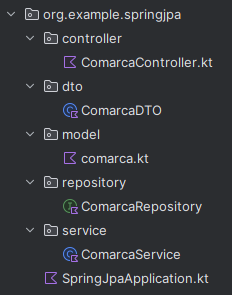

# Servicios y DTO

Hasta ahora, los ejemplos mostraban cómo devolver directamente las entidades desde el controlador. Aunque esto funciona, no es una buena práctica en aplicaciones reales, ya que expone el modelo de la base de datos y puede provocar problemas de seguridad y mantenimiento.

En este ejemplo se introduce el uso de DTO (Data Transfer Object) para separar las entidades JPA de los datos que se envían al cliente.

En los primeros ejemplos el controlador llamaba al repositorio. Recuperamos ahora la capa de servicio que ya utilizamos en Ficheros: concentra la lógica de negocio y puede transformar entidades en DTO. Un servicio es útil aunque no utilicemos DTO.
En resumen, el repositorio sigue trabajando con entidades, el servicio transforma esas entidades en DTO y el controlador devuelve los DTO al cliente.

**Hasta ahora el Controller**|**Con Service + DTO**, el objetivo es
-----------------------------|------------------------------------
- Accede directamente al Repository|- El controller solo gestiona peticiones y vistas
- Trabaja con entidades JPA|- La lógica de negocio y transformación va al Service
- Decide qué datos se muestran en la vista|
 BD → Entity → Repository → Controller → Vista| BD → Entity → Repository → Service → DTO → Controller → Vista

**Cuándo utilizar DTO en las operaciones CRUD**{.azul}

Los DTO se utilizan para leer y comunicar datos, no para persistirlos:

| Operación | Uso de DTO | Explicación |
|----------|-----------|-------------|
| ➕ CREATE | ⚠️ A veces | Normalmente se puede usar directamente la **entidad**. El **DTO solo es necesario** si el formulario no coincide con la entidad. |
| 🔍 READ | ✅ Sí | Al listar o mostrar datos es **recomendable usar DTO**, ya que los datos salen de la aplicación hacia el exterior. |
| ✏️ UPDATE | ⚠️ A veces | Se utiliza DTO cuando **no queremos permitir modificar todos los campos** de la entidad. |
| 🗑️ DELETE | ❌ No | No se usa DTO, ya que únicamente se envía el **identificador** del objeto a eliminar. |

**Cambios que se introducen en cada capa**{.azul}

👉**Paquetes que NO cambian al usar DTO**

- **model** → Las entidades JPA (@Entity) siguen siendo las mismas.

- **repository** → Continúa trabajando con entidades y Spring Data JPA.

👉**Paquetes que SÍ cambian al usar DTO**

- **dto** (nuevo paquete) → No depende de JPA y No tiene anotaciones

**ComarcaDTO.kt**

        package org.example.springjpa.dto

        data class ComarcaDTO(
            val nomC: String,         //Cambiamos nom_c → nomC (más claro para la API)
            val provincia: String?
        )

- **service** (nuevo paquete) → Aquí es donde introducimos DTO correctamente.

**ComarcaService.kt**

        package org.example.springjpa.service

        import org.example.springjpa.dto.ComarcaDTO
        import org.example.springjpa.repository.ComarcaRepository
        import org.springframework.stereotype.Service

        @Service
        class ComarcaService(
            private val comarcaRepository: ComarcaRepository //inyecta el Repository
        ) {

            /**
            * Devuelve el listado completo de comarcas.
            * Se define en la capa Service para separar la lógica de negocio
            * del controller y devolver los datos ya transformados en DTO,
            * evitando que la vista trabaje directamente con entidades.
            */
            fun obtenerComarcas(): List<ComarcaDTO> {   //los datos van a salir hacia la vista
                return comarcaRepository.findAll()
                    .map { comarca ->     //Se usa map para transformar cada entidad en un DTO
                        ComarcaDTO(       //Se seleccionan solo los campos necesarios
                            nomC = comarca.nomC, //Se pueden renombrar campos
                            provincia = comarca.provincia
                        )
                    }
            }

            // Método específico para buscar comarcas por provincia.
            //Se define para que el controller no acceda al repository
            // y para centralizar la conversión Entity → DTO.

            fun obtenerComarcasPorProvincia(provincia: String): List<ComarcaDTO> {
                return comarcaRepository.findByProvincia(provincia)
                    .map {
                        ComarcaDTO(
                            nomC = it.nomC,
                            provincia = it.provincia ?: ""
                        )
                    }
             }
        }

- **controller** → Cambiamo sel conrolador. Ahora devuelve DTO

**ComarcaRestController.kt**

        package org.example.springjpa.controller

        import org.example.springjpa.dto.ComarcaDTO
        import org.example.springjpa.service.ComarcaService
        import org.springframework.web.bind.annotation.*

        @RestController
        @RequestMapping("/api/comarcas")
        class ComarcaController(
            private val comarcaService: ComarcaService
        ) {

            // Listado general
            @GetMapping
            fun obtenerComarcas(): List<ComarcaDTO> =
                comarcaService.obtenerComarcas()

            // Búsqueda por provincia
            @GetMapping("/buscar")
            fun obtenerComarcasPorProvincia(
                @RequestParam provincia: String
            ): List<ComarcaDTO> =
                comarcaService.obtenerComarcasPorProvincia(provincia)
        }

!!!Tip ""
    El DTO no afecta a cómo se accede a la aplicación, sino a qué información se devuelve y cómo se presenta.

-----------

Sustituye la versión anterior del controlador REST; no mantengas dos controladores para `/api/comarcas`. En las operaciones de escritura del proyecto utiliza DTO de entrada con los campos permitidos y coloca `@Transactional` en los métodos de servicio que deban ejecutarse como una unidad.
