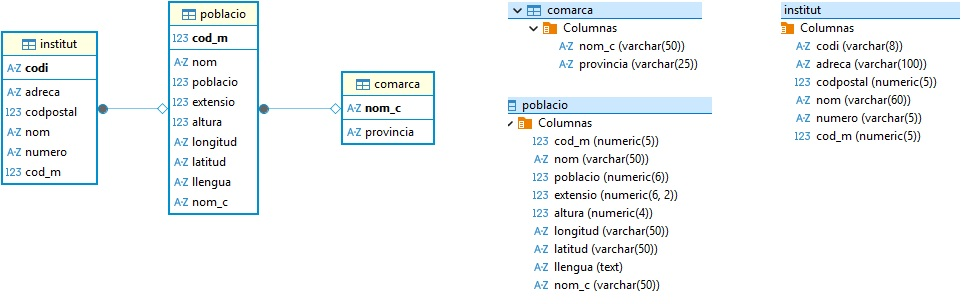
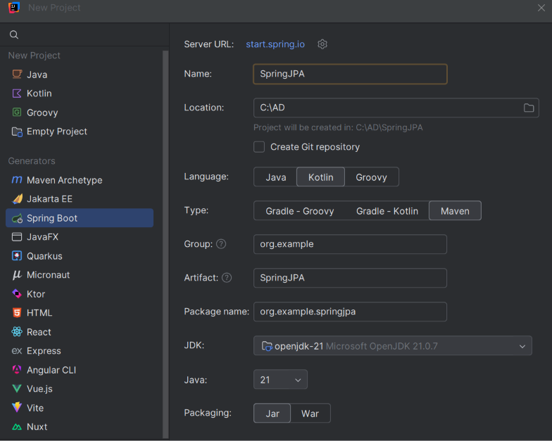
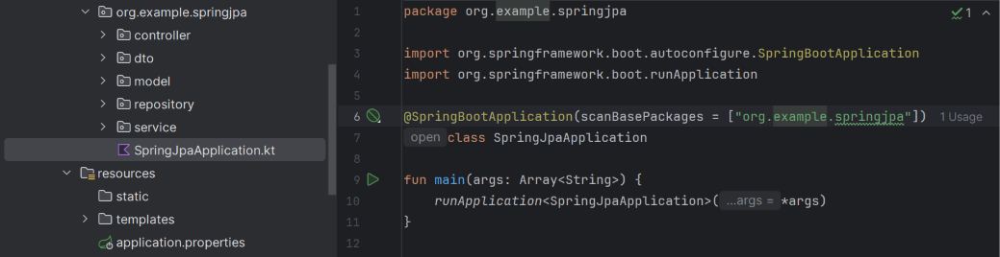

# Preparación del proyecto

## Base de datos

En este tema trabajaremos con la base de datos **`geo`** de PostgreSQL, con la que ya hemos trabajado en el tema 5 con JDBC, y que contiene información sobre comarcas, poblaciones e institutos. Sobre estos datos construiremos una aplicación con **Spring Boot y Spring Data JPA**.

Mantener las tablas y los datos nos permitirá centrarnos en cómo cambia el acceso a la información: pasaremos de escribir las sentencias SQL y transformar sus resultados manualmente a trabajar con entidades y repositorios.

Reutiliza la base de datos **`geo`** del T5 y comprueba que el servidor PostgreSQL está arrancado y tiene datos en `comarca`, `poblacio` e `institut`. Si todavía no la tienes, sigue la [preparación de PostgreSQL y geo](../Docker_instrucciones.md).



## Crear la aplicación desde IntelliJ IDEA

En el tema 4, sobre Ficheros, creamos el proyecto con Gradle desde la web de Spring Initializr. En este tema utilizaremos **Maven y el asistente de Spring Boot integrado en IntelliJ IDEA**, para conocer otra forma de preparar una aplicación. El lenguaje seguirá siendo **Kotlin**: Maven se encarga de las dependencias, la compilación y el empaquetado.

1. Abre **File → New → Project**.
2. Selecciona **Spring Boot** en el asistente.
3. Configura estas opciones:

| Opción | Valor |
|---|---|
| Name | `SpringJPA` |
| Language | **Kotlin** |
| Type / Build system | **Maven** |
| Group | `org.example` |
| Artifact | `springjpa` |
| Package name | `org.example.springjpa` |
| Packaging | Jar |
| JDK y Java | **JDK 21**. Selecciona Java 21 al crear el proyecto y utiliza ese mismo JDK como Project SDK y para ejecutar Maven en IntelliJ. Todos los proyectos deben compilarse y ejecutarse con esta versión. |




4. En la selección de dependencias, añade **Spring Web**, **Spring Data JPA**, **PostgreSQL Driver**, **Thymeleaf** y **Validation**.
5. Finaliza la creación y espera a que IntelliJ importe el proyecto y descargue sus dependencias.

Seleccionamos todas las dependencias desde el principio porque es más sencillo hacerlo con el asistente que incorporarlas manualmente al `pom.xml` más adelante. Así reducimos los errores de configuración y dejamos preparado el proyecto para todo el tema. **No las utilizaremos todas de inmediato**: iremos explicando su función conforme avancemos.

| Dependencia | Para qué la utilizaremos |
|---|---|
| Spring Web | En la [primera aplicación](primera_aplicacion.md), para atender peticiones HTTP desde un controlador. |
| Spring Data JPA | Para trabajar con entidades y repositorios y acceder a los datos. |
| PostgreSQL Driver | Para conectar la aplicación con PostgreSQL. |
| Thymeleaf | En el apartado de [vistas](vistas.md), para generar páginas HTML. |
| Validation | Cuando utilicemos validaciones con anotaciones como `@NotBlank` o `@Valid`. No es necesaria para las comprobaciones manuales con condicionales. |

!!!Note "Spring Initializr"
    El asistente utiliza Spring Initializr internamente, pero realizamos los pasos desde IntelliJ. Si tu instalación no muestra la opción Spring Boot, puedes generar el mismo proyecto en [Spring Initializr](https://start.spring.io/), seleccionando **Maven y Kotlin**, y abrir su `pom.xml` en IntelliJ.

## El archivo pom.xml

Maven utiliza **`pom.xml`** para describir el proyecto y gestionar sus dependencias y plugins. Conserva las versiones compatibles generadas por el asistente.

Por ejemplo, al seleccionar Spring Data JPA y PostgreSQL se incorporan estas dependencias dentro de `<dependencies>`:

```xml
<dependency>
    <groupId>org.springframework.boot</groupId>
    <artifactId>spring-boot-starter-data-jpa</artifactId>
</dependency>
<dependency>
    <groupId>org.postgresql</groupId>
    <artifactId>postgresql</artifactId>
    <scope>runtime</scope>
</dependency>
```

No las añadas otra vez si ya están presentes. Spring Boot gestiona sus versiones. Cuando modifiques el `pom.xml`, utiliza **Reload All Maven Projects** en la ventana de Maven para actualizar el proyecto.


### El plugin de Kotlin

Busca **`kotlin-maven-plugin`** en `pom.xml` con **Ctrl+F**. Debe estar dentro de **`<build>` → `<plugins>`**, no en el bloque de dependencias de la aplicación. Dentro de su configuración encontrarás los plugins de compilador `spring` y `jpa`.

Este fragmento muestra dónde se sitúa cada elemento. Es un **esquema orientativo**, no un `pom.xml` completo: conserva las versiones, dependencias, ejecuciones y demás opciones que haya generado el asistente.

```xml
<build>
    <plugins>
        <!-- Aqui puede haber otros plugins, como el de Spring Boot -->

        <plugin>
            <groupId>org.jetbrains.kotlin</groupId>
            <artifactId>kotlin-maven-plugin</artifactId>

            <configuration>
                <!-- Conserva las demas opciones de compilacion -->
                <compilerPlugins>
                    <plugin>spring</plugin>
                    <plugin>jpa</plugin>
                </compilerPlugins>
            </configuration>

            <!-- Conserva las dependencias y ejecuciones de este plugin -->
        </plugin>
    </plugins>
</build>
```

- **`kotlin-maven-plugin`** permite compilar el código Kotlin con Maven.
- **`spring` y `jpa`** son plugins del compilador Kotlin, configurados dentro de `compilerPlugins`; no son dependencias de la aplicación.
- Si el plugin contiene su propio bloque **`<dependencies>`**, déjalo dentro del plugin. No lo confundas con el bloque de dependencias general donde están Spring Data JPA y PostgreSQL.
- Si estos elementos ya existen, **no los dupliques ni sustituyas el plugin completo por este fragmento**. Después de cualquier cambio, recarga el proyecto Maven.

Los plugins de compilador adaptan las clases Kotlin a las necesidades de Spring y JPA, como los constructores sin argumentos de las entidades. Desde Kotlin 2.3.20, el plugin `jpa` también incorpora la apertura de las clases JPA; conserva la configuración generada para tu versión.
<!--
??? note "Si utilizas una versión anterior de Kotlin"
    Puede ser necesario configurar explícitamente `all-open` para las entidades. Integra estos elementos en el plugin Kotlin existente, conservando sus demás opciones y ejecuciones:

    ```xml
    <configuration>
        <compilerPlugins>
            <plugin>spring</plugin>
            <plugin>jpa</plugin>
            <plugin>all-open</plugin>
        </compilerPlugins>
        <pluginOptions>
            <option>all-open:annotation=jakarta.persistence.Entity</option>
            <option>all-open:annotation=jakarta.persistence.MappedSuperclass</option>
            <option>all-open:annotation=jakarta.persistence.Embeddable</option>
        </pluginOptions>
    </configuration>
    <dependencies>
        <dependency>
            <groupId>org.jetbrains.kotlin</groupId>
            <artifactId>kotlin-maven-allopen</artifactId>
            <version>${kotlin.version}</version>
        </dependency>
        <dependency>
            <groupId>org.jetbrains.kotlin</groupId>
            <artifactId>kotlin-maven-noarg</artifactId>
            <version>${kotlin.version}</version>
        </dependency>
    </dependencies>
    ```

    Estas dependencias pertenecen al plugin Kotlin, dentro de `<build><plugins>`, no al bloque de dependencias de la aplicación. No dupliques elementos que el asistente ya haya generado.

Referencias: [asistente de Spring Boot en IntelliJ](https://www.jetbrains.com/help/idea/spring-initializr-project-wizard.html), [plugin JPA de Kotlin](https://kotlinlang.org/docs/no-arg-plugin.html) y [cambios de Kotlin 2.3.20](https://kotlinlang.org/docs/whatsnew2320.html).
-->
## Organización

En la raíz encontrarás `pom.xml` y el wrapper de Maven (`mvnw` y `mvnw.cmd`). Dentro de `src/main`, la estructura inicial básica incluye la clase de arranque y el archivo de configuración:

```text
src/main/
├── kotlin/org/example/springjpa/
│   └── SpringjpaApplication.kt
└── resources/
    └── application.properties
```

Los paquetes **`model`, `repository`, `controller`, `service` y `dto` no los genera automáticamente Spring**. Los crearás tú dentro de `org.example.springjpa` conforme los necesites en los siguientes apartados. También crearás la carpeta `templates` dentro de `resources` cuando trabajemos con las vistas, si todavía no existe.

El siguiente esquema muestra la **organización que iremos construyendo a lo largo del tema**, no la estructura que debes encontrar al crear el proyecto. No necesitas crear todos estos paquetes ahora:

```text
src/main/
├── kotlin/org/example/springjpa/
│   ├── SpringjpaApplication.kt
│   ├── model/
│   ├── repository/
│   ├── controller/
│   ├── service/
│   └── dto/
└── resources/
    ├── application.properties
    └── templates/
```

Mantén la clase de arranque generada en `org.example.springjpa` y crea los componentes dentro de sus subpaquetes. Cada apartado indicará qué archivos y paquetes necesitas añadir.

## Conexión a PostgreSQL

Configura `src/main/resources/application.properties`:

```properties
spring.application.name=springjpa
spring.datasource.url=jdbc:postgresql://localhost:5432/geo
spring.datasource.username=postgres
spring.datasource.password=postgres
spring.jpa.hibernate.ddl-auto=none
spring.jpa.show-sql=true
spring.jpa.properties.hibernate.format_sql=true
```

Son las credenciales del entorno local del T5; adapta los valores si tu instalación es diferente.  Spring configura las conexiones a partir de estas propiedades.

* `ddl-auto=none` evita que Hibernate cree o modifique las tablas. 
* `show-sql` permite observar el SQL generado. 

En [Creación y actualización de las tablas](creacion_bd.md) se explican las opciones `none`, `validate`, `update`, `create` y `create-drop`, y cómo inicializar una base con scripts SQL. En este tema conservamos `none` porque reutilizamos `geo`.

## Puesta en marcha

El asistente ya ha creado la clase de arranque **`SpringjpaApplication`**, anotada con `@SpringBootApplication`, y la función `main`. Al ejecutar esa función se inicia la aplicación y Spring configura sus componentes. La clase no se crea al arrancar: forma parte del código generado al preparar el proyecto. Conserva el nombre que haya generado tu asistente.



Ejecuta la clase de arranque y comprueba en la consola que Spring inicia sin errores de conexión a PostgreSQL.


Como ya hemos incluido Spring Web, se inicia el servidor web integrado, que escucha por defecto en el puerto **8080**. Todavía no hemos creado controladores ni páginas, por lo que abrir la dirección raíz en el navegador puede mostrar una página de error 404; esto no significa que el arranque haya fallado. En la primera aplicación crearemos una ruta y probaremos el acceso por HTTP.
