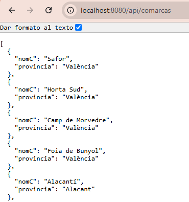
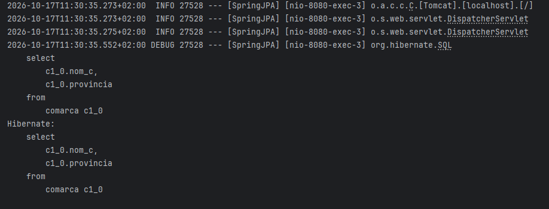

# Primera aplicación Web

Partimos del [proyecto y la conexión local](entorno.md). Nuestro objetivo es **consultar las comarcas de la base de datos desde el navegador**: al abrir `http://localhost:8080/api/comarcas`, la aplicación devolverá los datos en formato JSON. De momento no construiremos una página HTML; veremos directamente la respuesta con los datos.

Para conseguirlo, representaremos la tabla `comarca` mediante una entidad JPA, crearemos un repositorio para recuperar los registros y un controlador para atender la petición del navegador. La clave primaria `nom_c` es de texto y ya existe.

## Spring Web en nuestra aplicación

**JPA se ocupa de la persistencia, pero no de recibir peticiones del navegador. Para esa parte utilizaremos Spring Web.** Al abrir la dirección anterior, el navegador enviará una petición HTTP de tipo GET. Spring Web permitirá dirigirla al método del controlador que consulta el repositorio y devolver su resultado como una respuesta JSON.

La dirección `/api/comarcas` será nuestro **endpoint**: el punto de acceso a esa operación de la aplicación. Spring Web es necesaria aquí porque hemos elegido ofrecer la consulta por HTTP; no es un requisito para utilizar JPA en una aplicación sin interfaz web.

**Spring Web ya está incluida** porque la seleccionamos al crear el proyecto desde IntelliJ IDEA. Incorporamos todas las dependencias al principio para simplificar la preparación y evitar tener que añadirlas manualmente al `pom.xml` durante el tema.

No necesitas añadir ninguna dependencia nueva ni modificar el `pom.xml` en este apartado.

Al ejecutar la aplicación con esta dependencia, el servidor web escuchará por defecto en el puerto **8080**.

Crea cada archivo en el paquete indicado. Usa clases ordinarias para entidades y conserva la configuración de Kotlin y JPA del `pom.xml` generado.


* **Entidad JPA**

Define las entidades que corresponden a las tablas existentes en la base de datos. No necesitas configuraciones especiales más allá de mapear las columnas.
En nuestro caso definimos la entidad comarca y sus campos.

En el paquete **model** crea un archivo llamado **comarca.kt**

```kotlin
package org.example.springjpa.model

import jakarta.persistence.*

@Entity // (1)!
@Table(name = "comarca") // (2)!
class Comarca(
    @Id // (3)!
    @Column(name = "nom_c") // (4)!
    var nomC: String = "",

    @Column(name = "provincia")
    var provincia: String? = null // (5)!
)
```

1. Marca la clase como entidad JPA: sus objetos representan registros de la base de datos.
2. Indica que la entidad corresponde a la tabla existente `comarca`.
3. Identifica la clave primaria. No usamos `@GeneratedValue` porque el nombre de la comarca ya es su identificador.
4. Relaciona la propiedad Kotlin `nomC` con la columna `nom_c`, cuyos nombres son diferentes.
5. El signo `?` permite representar un valor `NULL` de la base de datos.


* **Repositorio**

Crea un repositorio que permita ejecutar consultas sobre la tabla correspondiente.

Dentro del paquete **repository**, crea un archivo llamado **ComarcaRepository.kt**

```kotlin
package org.example.springjpa.repository

import org.example.springjpa.model.Comarca
import org.springframework.data.jpa.repository.JpaRepository

interface ComarcaRepository : JpaRepository<Comarca, String> { // (1)!
    fun findByProvincia(provincia: String): List<Comarca> // (2)!
}
```

1. El repositorio trabaja con entidades `Comarca` cuya clave primaria es `String`. Hereda operaciones como `findAll()`, `findById()` y `save()`. Spring Data JPA proporciona la implementación: no escribimos una clase que implemente esta interfaz.
2. Spring Data JPA interpreta el nombre del método y crea una consulta que filtra por la propiedad `provincia`. Devuelve una lista, que estará vacía si no hay coincidencias. Utilizaremos esta búsqueda más adelante.

* **Controlador**

El controlador manejará las solicitudes GET para obtener información de la base de datos.

Dentro del paquete **controller**, crea un archivo llamado **ComarcaRestController.kt**

```kotlin
package org.example.springjpa.controller

import org.example.springjpa.model.Comarca
import org.example.springjpa.repository.ComarcaRepository
import org.springframework.web.bind.annotation.*

@RestController // (1)!
@RequestMapping("/api/comarcas") // (2)!
class ComarcaController(private val comarcaRepository: ComarcaRepository) { // (3)!

    @GetMapping // (4)!
    fun obtenerComarcas(): List<Comarca> = comarcaRepository.findAll() // (5)!
}
```

1. Identifica un controlador que devuelve datos en el cuerpo de la respuesta, no el nombre de una plantilla HTML. En este ejemplo, Spring convierte la lista a JSON mediante Jackson.
2. Establece la ruta base de este controlador: `/api/comarcas`.
3. Spring proporciona el repositorio mediante el constructor. No necesitamos crearlo manualmente; esto se llama inyección de dependencias.
4. Asocia el método a las peticiones HTTP GET. Como no añade otra ruta, atiende `GET /api/comarcas`.
5. `findAll()` recupera todas las comarcas como entidades. Hibernate genera la consulta SQL y el método devuelve la lista, que se enviará al navegador como JSON.


`JpaRepository<Comarca, String>` indica el tipo de entidad y el tipo de su identificador. `findAll()` recupera las entidades; ya no escribimos el bucle del `ResultSet`. La clase del controlador se llama `ComarcaController` aunque el archivo se denomine `ComarcaRestController.kt`.


## Probar la aplicación

Arranca la aplicación y abre [GET /api/comarcas](http://localhost:8080/api/comarcas). Comprueba que devuelve JSON y compara los datos con `SELECT nom_c, provincia FROM comarca` en DBeaver.



Observa en la consola la consulta SQL generada automáticamente. **Hibernate**, la implementación de JPA que utiliza nuestro proyecto, la genera a partir de la llamada a `findAll()` del repositorio. Recuerda que la propiedad `spring.jpa.show-sql=true` permite mostrar ese SQL en la consola.




