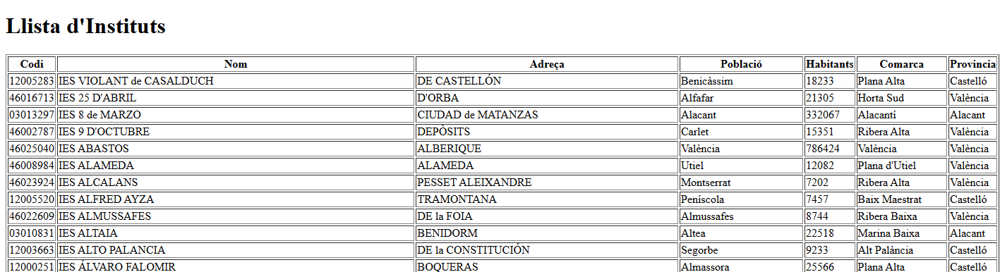

# Relaciones entre entidades

Hasta ahora cada consulta trabajaba con `Comarca`. Ahora queremos mostrar un instituto junto con su población y comarca, sin construir manualmente cada objeto relacionado como hacíamos con JDBC.

## Comprender las relaciones

En `geo`, una comarca puede tener muchas poblaciones y una población puede tener muchos institutos. Desde el otro lado, cada población puede referenciar una comarca y cada instituto puede referenciar una población. En este esquema las claves foráneas admiten valores nulos.

```text
Institut -- cod_m --> Poblacio -- nom_c --> Comarca
```

En Kotlin representaremos esas referencias como propiedades de tipo `Poblacio?` y `Comarca?`. La anotación `@ManyToOne` significa «muchos registros pueden apuntar al mismo registro relacionado». `@JoinColumn` indica la columna de la clave foránea en la tabla de origen.

No añadiremos listas inversas con `@OneToMany`: no son necesarias para estas consultas. Tampoco activaremos borrados en cascada ni modificaremos el esquema de PostgreSQL.

??? note "¿Cuándo utilizar @OneToMany?"
    `@ManyToOne` permite acceder desde una población a su comarca mediante `poblacion.comarca`. Añadir `@OneToMany` en la entidad `Comarca` permitiría recorrer sus poblaciones mediante una colección, como `comarca.poblaciones`.

    Resulta útil cuando necesitamos navegar habitualmente desde un objeto hacia sus elementos relacionados. No es obligatorio añadirlo por tener un `@ManyToOne`: podemos representar solo el sentido de la relación que necesitamos.

    En estos ejemplos obtenemos las poblaciones de una comarca consultando el repositorio con `findByComarcaNomC(...)`, por lo que no necesitamos añadir esa colección a la entidad.

## Entidades y archivos

Conserva **una sola clase `Comarca`** y crea `model/Poblacio.kt` y `model/Institut.kt`. Si ya existen, actualízalas; no copies una segunda definición. Los campos con `?` permiten representar los valores nulos de la base de datos.

Los ejemplos siguientes muestran primero las relaciones y después su consulta. La parte HTML reutiliza lo aprendido con Thymeleaf; la parte REST utiliza servicios y DTO.


### Comarca: conservar la entidad existente

```kotlin
package org.example.springjpa.model

import jakarta.persistence.*

@Entity
@Table(name = "comarca")
class Comarca(
    @Id
    @Column(name = "nom_c")
    var nomC: String = "",

    @Column(name = "provincia")
    var provincia: String? = null
)
```

### Poblacio: referencia a la comarca

```kotlin
package org.example.springjpa.model

import jakarta.persistence.*

@Entity
@Table(name = "poblacio")
class Poblacio(
    @Id
    @Column(name = "cod_m")
    var codM: Int = 0,

    @Column(name = "nom")
    var nom: String = "",

    @Column(name = "poblacio") // (3)!
    var poblacio: Int? = null,

    @Column(name = "extensio")
    var extensio: Double? = null,

    @Column(name = "altura")
    var altura: Int? = null,

    @Column(name = "longitud")
    var longitud: String? = null,

    @Column(name = "latitud")
    var latitud: String? = null,

    @Column(name = "llengua")
    var llengua: String? = null,

    @ManyToOne // (1)!
    @JoinColumn(name = "nom_c", referencedColumnName = "nom_c") // (2)!
    var comarca: Comarca? = null
)
```

1. Muchas poblaciones pueden pertenecer a una misma comarca. La propiedad guarda una referencia a una entidad, no solo su nombre.
2. La columna `poblacio.nom_c` referencia `comarca.nom_c`. Hibernate usa ese mapeo para resolver la relación.
3. Número de habitantes

### Institut: referencia a la población

```kotlin
package org.example.springjpa.model

import jakarta.persistence.*

@Entity
@Table(name = "institut")
class Institut(
    @Id
    @Column(name = "codi")
    var codi: String = "",

    @Column(name = "adreca")
    var adreca: String? = null,

    @Column(name = "codpostal")
    var codPostal: Int? = null,

    @Column(name = "nom")
    var nom: String? = null,

    @Column(name = "numero")
    var numero: String? = null,

    @ManyToOne // (1)!
    @JoinColumn(name = "cod_m", referencedColumnName = "cod_m") // (2)!
    var poblacio: Poblacio? = null // (3)!
)
```

1. Varios institutos pueden referenciar la misma población.
2. `institut.cod_m` es la clave foránea. No necesitas mapear además otro campo editable `codM` en `Institut` para la misma columna: puedes leer el código mediante `institut.poblacio?.codM`.
3. objeto de población relacionado

## Consultas sobre relaciones

Conserva tu `ComarcaRepository` con `findByProvincia` y la ordenación de los apartados anteriores. No necesitas sustituirlo.

Crea los otros dos repositorios dentro del paquete `repository`. Los nombres se forman con **propiedades Kotlin**, no con las columnas SQL. Por ejemplo, `findByPoblacioComarcaProvincia` recorre `institut.poblacio.comarca.provincia`; los puntos sirven aquí para explicar el recorrido, pero no se escriben en el nombre del método.

### InstitutRepository.kt

```kotlin
package org.example.springjpa.repository

import org.example.springjpa.model.Institut
import org.springframework.data.jpa.repository.JpaRepository

interface InstitutRepository : JpaRepository<Institut, String> {
    // Obtener institutos de una población
    fun findByPoblacioNom(nom: String): List<Institut>

    // Filtrar por codigo, como se pide en el proyecto final
    fun findByPoblacioCodM(codM: Int): List<Institut>

    // Obtener institutos de una comarca
    fun findByPoblacioComarcaNomC(nomC: String): List<Institut>

    // Obtener institutos de una provincia
    fun findByPoblacioComarcaProvincia(provincia: String): List<Institut> // (1)!

    // Obtener institutos cuya población es mayor a
    fun findByPoblacioPoblacioGreaterThan(poblacio: Int): List<Institut>


}
```

1. El nombre recorre tres propiedades: `Institut.poblacio`, `Poblacio.comarca` y `Comarca.provincia`. Los registros sin esas relaciones no coinciden con un filtro por provincia.

### PoblacioRepository.kt

```kotlin
package org.example.springjpa.repository

import org.example.springjpa.model.Poblacio
import org.springframework.data.jpa.repository.JpaRepository

interface PoblacioRepository : JpaRepository<Poblacio, Int> {

    // Obtener poblaciones de una comarca
    fun findByComarcaNomC(nomC: String): List<Poblacio>

    // Obtener poblaciones de una provincia
    fun findByComarcaProvincia(provincia: String): List<Poblacio>

}
```

## Mostrar las relaciones en HTML

Crea los siguientes controladores en `controller` y las dos plantillas en `resources/templates`. No sustituyen el controlador de comarcas, porque utilizan rutas diferentes. Aquí reutilizamos el acceso directo al repositorio del primer ejemplo HTML; más abajo aislaremos las lecturas REST en servicios.

### InstitutMvcController.kt

```kotlin
package org.example.springjpa.controller


import org.example.springjpa.repository.InstitutRepository
import org.springframework.stereotype.Controller
import org.springframework.ui.Model
import org.springframework.web.bind.annotation.*

@Controller
@RequestMapping("/instituts")
class InstitutController(private val institutRepository: InstitutRepository) {

    //Muestra todos los intitutos
    @GetMapping
    fun listarInstituts(model: Model): String {
        val instituts = institutRepository.findAll()
        model.addAttribute("instituts", instituts)
        return "instituts"
    }

    // Muestra institutos de una población
    @GetMapping("/por-poblacio")
    fun obtenerInstitutsPoblacio(@RequestParam poblacio: String, model: Model): String {
        val institutsPoblacio = institutRepository.findByPoblacioNom(poblacio)
        model.addAttribute("instituts", institutsPoblacio)
        return "instituts" // Plantilla para mostrar la lista de institutos
    }

    // Muestra institutos de una comarca
    @GetMapping("/por-comarca")
    fun obtenerInstitutsComarca(@RequestParam comarca: String, model: Model): String {
        val institutsComarca = institutRepository.findByPoblacioComarcaNomC(comarca)
        model.addAttribute("instituts", institutsComarca)
        return "instituts" // Plantilla para mostrar la lista de institutos
    }


    // Muestra institutos de una provincia
    @GetMapping("/por-provincia")
    fun obtenerInstitutsProvincia(@RequestParam provincia: String, model: Model): String {
        val institutsProvincia = institutRepository.findByPoblacioComarcaProvincia(provincia)
        model.addAttribute("instituts", institutsProvincia)
        return "instituts" // Plantilla para mostrar la lista de institutos
    }


    // Muestra institutos con población superior a un valor
    @GetMapping("/poblacion-superior")
    fun obtenerInstitutsPoblacionSuperior(@RequestParam poblacio: Int, model: Model): String {
        val institutsConPoblacionSuperiorA = institutRepository.findByPoblacioPoblacioGreaterThan(poblacio)
        model.addAttribute("instituts", institutsConPoblacionSuperiorA)
        return "instituts" // Plantilla para mostrar la lista de institutos
    }
}
```

### PoblacioMvcController.kt

```kotlin
package org.example.springjpa.controller

import org.example.springjpa.repository.PoblacioRepository
import org.springframework.stereotype.Controller
import org.springframework.ui.Model
import org.springframework.web.bind.annotation.*


@Controller
@RequestMapping("/poblacions")
class PoblacioController(private val poblacioRepository: PoblacioRepository) {

    // Muestra todas las poblaciones
    @GetMapping
    fun listarTodasPoblacions(model: Model): String {
        val poblacions = poblacioRepository.findAll()
        model.addAttribute("poblacions", poblacions)
        return "poblacions" // Vista Thymeleaf para mostrar todas las poblaciones
    }

    // Muestra las poblaciones por comarca
    @GetMapping("/por-comarca")
    fun listarPoblacionsPorComarca(@RequestParam comarca: String, model: Model): String {
        val poblacions = poblacioRepository.findByComarcaNomC(comarca)
        model.addAttribute("poblacions", poblacions)
        return "poblacions" // Vista Thymeleaf para mostrar las poblaciones por comarca
    }

    @GetMapping("/por-provincia")
    fun listarPoblacionsPorProvincia(@RequestParam provincia: String, model: Model): String {
        val poblacions = poblacioRepository.findByComarcaProvincia(provincia)
        model.addAttribute("poblacions", poblacions)
        return "poblacions" // Vista Thymeleaf para mostrar las poblaciones por comarca
    }
}
```

### Plantilla instituts.html

```html
<!DOCTYPE html>
<html xmlns:th="http://www.thymeleaf.org">

<head>
    <title>Instituts</title>
</head>
<body>
<h1>Llista d'Instituts</h1>
<table border="1">
    <tr>
        <th>Codi</th>
        <th>Nom</th>
        <th>Adreça</th>
        <th>Població</th>
        <th>Habitants</th>
        <th>Comarca</th>
        <th>Provincia</th>

    </tr>
    <tr th:each="institut : ${instituts}">
        <td th:text="${institut.codi}">Codi</td>
        <td th:text="${institut.nom}">Nom</td>
        <td th:text="${institut.adreca}">Adreça</td>
        <td th:text="${institut.poblacio?.nom}">Població</td>
        <td th:text="${institut.poblacio?.poblacio}">Habitants</td>
        <td th:text="${institut.poblacio?.comarca?.nomC}">Comarca</td>
        <td th:text="${institut.poblacio?.comarca?.provincia}">Provincia</td>


    </tr>
</table>
</body>
</html>
```

### Plantilla poblacions.html

```html
<!DOCTYPE html>
<html xmlns:th="http://www.thymeleaf.org">

<head>
<title>Poblacions</title>
</head>
<body>
<h1>Llista de Poblacions per Comarca</h1>
<table border="1">
<tr>
    <th>Codi</th>
    <th>Nom</th>
    <th>Comarca</th>
    <th>Provincia</th>
</tr>
<tr th:each="poblacio : ${poblacions}">
    <td th:text="${poblacio.codM}">Codi</td>
    <td th:text="${poblacio.nom}">Nom</td>
    <td th:text="${poblacio.comarca?.nomC}">Comarca</td>
    <td th:text="${poblacio.comarca?.provincia}">Provincia</td>


</tr>
</table>
</body>
</html>
```

### Comprobar las páginas

* Todos los institutos: [http://localhost:8080/instituts](http://localhost:8080/instituts)
* Todas las poblaciones: [http://localhost:8080/poblacions](http://localhost:8080/poblacions)
* Todas las comarcas: [http://localhost:8080/comarcas](http://localhost:8080/comarcas)
* Listar institutos de una población: [http://localhost:8080/instituts/por-poblacio?poblacio=Gandia](http://localhost:8080/instituts/por-poblacio?poblacio=Gandia)
* Listar institutos de una comarca: [http://localhost:8080/instituts/por-comarca?comarca=Safor](http://localhost:8080/instituts/por-comarca?comarca=Safor)
* Listar institutos de una provincia: [http://localhost:8080/instituts/por-provincia?provincia=Alacant](http://localhost:8080/instituts/por-provincia?provincia=Alacant)
* Listar comarcas de una provincia: [http://localhost:8080/comarcas/buscar?provincia=Alacant](http://localhost:8080/comarcas/buscar?provincia=Alacant)
* Listar poblaciones de una comarca [http://localhost:8080/poblacions/por-comarca?comarca=Safor](http://localhost:8080/poblacions/por-comarca?comarca=Safor)
* Listar poblaciones de una provincia: [http://localhost:8080/poblacions/por-provincia?provincia=Alacant](http://localhost:8080/poblacions/por-provincia?provincia=Alacant)
* Listar institutos con población superior a un valor: [http://localhost:8080/instituts/poblacion-superior?poblacio=20000](http://localhost:8080/instituts/poblacion-superior?poblacio=20000)




## Devolver las relaciones como JSON

- Las entidades NO cambian
- Los repositorios NO cambian
- Se añaden DTO y servicios para poblaciones e institutos.
- Los nuevos controladores REST devuelven DTO como JSON; los controladores HTML se conservan.

En este ejemplo mostraremos los resultados en JSON y por tanto utilizaremos los controladores REST.

### DTO de salida

El paquete `dto` y `ComarcaDTO` ya existen. Consérvalos. Crea **`dto/PoblacioDTO.kt`** y **`dto/InstitutDTO.kt`**, cada uno con su declaración `package`. Los DTO contienen valores sencillos, no entidades relacionadas.

```kotlin
package org.example.springjpa.dto


data class PoblacioDTO(
    val codM: Int,
    val nom: String,
    val poblacio: Int?,
    val comarcaNom: String?
)
```

**Archivo `dto/InstitutDTO.kt`:**

```kotlin
package org.example.springjpa.dto

data class InstitutDTO(
    val codi: String,
    val nom: String?,
    val adreca: String?,
    val poblacioNom: String?,
    val comarcaNom: String?,
    val provincia: String?
)
```

### Servicio de poblaciones

Crea **`service/PoblacioService.kt`**. No es un paquete nuevo: `PoblacioService` es una clase dentro del paquete `service`.

```kotlin
package org.example.springjpa.service

import org.example.springjpa.dto.PoblacioDTO
import org.example.springjpa.repository.PoblacioRepository
import org.springframework.stereotype.Service
import org.springframework.transaction.annotation.Transactional

@Service
@Transactional(readOnly = true)
class PoblacioService(
    private val poblacioRepository: PoblacioRepository
) {

    fun obtenerPoblacionesPorComarca(nomC: String): List<PoblacioDTO> =
        poblacioRepository.findByComarcaNomC(nomC).map {
            PoblacioDTO(
                codM = it.codM,
                nom = it.nom,
                poblacio = it.poblacio,
                comarcaNom = it.comarca?.nomC // (1)!
            )
        }
}
```

1. `?.` accede al nombre solo si hay una comarca relacionada. Si no existe, conserva `null`. La conversión se realiza dentro de la transacción de lectura del servicio.

### Servicio de institutos

Crea **`service/InstitutService.kt`**. Conserva `ComarcaService`.

```kotlin
package org.example.springjpa.service

import org.example.springjpa.dto.InstitutDTO
import org.example.springjpa.repository.InstitutRepository
import org.springframework.stereotype.Service
import org.springframework.transaction.annotation.Transactional

@Service
@Transactional(readOnly = true)
class InstitutService(
    private val institutRepository: InstitutRepository
) {

    fun obtenerInstitutosPorProvincia(provincia: String): List<InstitutDTO> =
        institutRepository.findByPoblacioComarcaProvincia(provincia)
            .map {
                InstitutDTO(
                    codi = it.codi,
                    nom = it.nom,
                    adreca = it.adreca,
                    poblacioNom = it.poblacio?.nom,
                    comarcaNom = it.poblacio?.comarca?.nomC,
                    provincia = it.poblacio?.comarca?.provincia
                )
            }
}
```

### Controladores REST

Crea **`controller/InstitutRestController.kt`**:

```kotlin
package org.example.springjpa.controller

import org.example.springjpa.service.InstitutService
import org.example.springjpa.dto.InstitutDTO
import org.springframework.web.bind.annotation.*

@RestController
@RequestMapping("/api/instituts")
class InstitutRestController(
    private val institutService: InstitutService
) {

    @GetMapping("/provincia")
    fun obtenirPerProvincia(
        @RequestParam provincia: String
    ): List<InstitutDTO> =
        institutService.obtenerInstitutosPorProvincia(provincia)
}
```

Crea **`controller/PoblacioRestController.kt`**:

```kotlin
package org.example.springjpa.controller

import org.example.springjpa.dto.PoblacioDTO
import org.example.springjpa.service.PoblacioService
import org.springframework.web.bind.annotation.*

@RestController
@RequestMapping("/api/poblacions")
class PoblacioRestController(
    private val poblacioService: PoblacioService
) {

    // Obtener poblaciones de una comarca
    @GetMapping("/comarca")
    fun obtenirPerComarca(
        @RequestParam nomC: String
    ): List<PoblacioDTO> =
        poblacioService.obtenerPoblacionesPorComarca(nomC)


}
```

* Listar las poblaciones de la Comarca del Ports: [http://localhost:8080/api/poblacions/comarca?nomC=Ports](http://localhost:8080/api/poblacions/comarca?nomC=Ports)


## Cómo utilizar una relación al crear un registro

Para el alta de un instituto, el cliente enviará el **código de una población existente**, no una población nueva. En el servicio, consulta `poblacioRepository.findById(codigo)`, comprueba que existe y asigna la entidad recuperada a `institut.poblacio` antes de guardar el instituto.

No crees una población ficticia para evitar la comprobación y no necesitas guardar de nuevo la población. Puedes seguir el manejo de errores de [Escritura desde la API](api_crud.md) para devolver 400 cuando el código de población recibido no exista.

### Ejemplo de alta con una población existente

Este ejemplo se centra en **cómo asignar la relación al crear un instituto**. No es el endpoint completo del proyecto: partimos de datos de prueba válidos y un código de instituto que todavía no exista. Las validaciones generales, el DTO de entrada y la respuesta de la API se construyen siguiendo el ejemplo de comarcas.

En `service/InstitutService.kt`, añade estos imports:

```kotlin
import org.example.springjpa.model.Institut
import org.example.springjpa.repository.PoblacioRepository
```

Modifica el constructor de la clase existente para recibir **los dos repositorios**. Conserva sus anotaciones y los métodos de consulta:

```kotlin
class InstitutService(
    private val institutRepository: InstitutRepository,
    private val poblacioRepository: PoblacioRepository // (1)!
) {
    // Conserva aqui los metodos existentes y añade el metodo siguiente.
}
```

1. Spring proporciona ambos repositorios mediante el constructor. Uno permite guardar el instituto y el otro consultar la población que ya existe. No creamos otro servicio con el mismo nombre.

Añade este método **dentro de la clase**, antes de su llave final. Utiliza `ErrorOperacion`, definida anteriormente en el mismo paquete `service`:

```kotlin
@Transactional // (1)!
fun crearEjemplo(
    codigo: String,
    nombre: String,
    direccion: String,
    codigoPoblacion: Int
) {
    val poblacion = poblacioRepository.findById(codigoPoblacion)
        .orElseThrow { ErrorOperacion(400, "La poblacion indicada no existe") } // (2)!

    val instituto = Institut(
        codi = codigo,
        nom = nombre,
        adreca = direccion,
        poblacio = poblacion // (3)!
    )

    institutRepository.save(instituto) // (4)!
}
```

1. Es una operación de escritura, por lo que sustituye la configuración `readOnly = true` de la clase. Debe llamarse desde otro componente al servicio gestionado por Spring.
2. Recuperamos una entidad `Poblacio` existente. Si no aparece, detenemos el alta: no creamos la población ni guardamos el instituto.
3. La propiedad `poblacio` recibe un **objeto `Poblacio`**, no el número recibido como argumento. Hibernate utiliza su clave `codM` para guardar la columna `cod_m` del instituto, según el mapeo de `@JoinColumn`.
4. Guardamos el instituto. No llamamos a `poblacioRepository.save(...)`, porque no estamos creando ni modificando la población.

El recorrido que debes comprender es:

```text
Código recibido → buscar Poblacio → asignarla a Institut.poblacio → guardar Institut
```

!!! note "Cómo trasladarlo al proyecto"
    Este método no recibe un DTO ni devuelve uno y presupone que los demás datos son válidos. En el proyecto, integra estos pasos en tu método de alta: recibe el DTO, valida los campos y comprueba el código duplicado, recupera la población, guarda el instituto y construye el DTO de respuesta. No añadas un endpoint de pruebas que omita esas comprobaciones.

## Integración y comprobación

Cada bloque corresponde a un archivo de su paquete. Conserva una sola definición de `Comarca`, `Poblacio` e `Institut`: sustituye las entidades anteriores. Las claves de `comarca` e `institut` son `String`; la de `poblacio` se representa con `Int`. Los campos numéricos del esquema se convierten al tipo Kotlin correspondiente.

Compara las consultas con las del T5. Comprueba un filtro con resultados y otro sin coincidencias. Los controladores MVC muestran plantillas; los REST devuelven DTO. Mantén accesible la sesión al convertir relaciones a DTO: anota las operaciones de lectura del servicio con `@Transactional(readOnly = true)` e importa `org.springframework.transaction.annotation.Transactional`.

Prueba también [institutos por provincia en JSON](http://localhost:8080/api/instituts/provincia?provincia=Alacant). En los DTO, `null` indica que falta una relación o un dato; no se sustituye por un texto inventado.

Para el proyecto final, estas lecturas son una referencia: amplía el servicio y el controlador de institutos con las operaciones aprendidas sobre comarcas. No añadas otro controlador con las mismas rutas.

