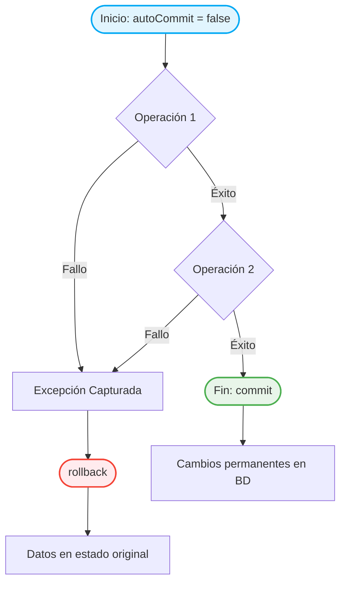

# Transacciones y manejo de excepciones

!!! warning "Entorno del ejemplo principal"
    Realiza `Ejemplo_transaccion.kt` en el proyecto **`BDRelacionales`**, dentro del paquete **`SQLite`**. El ejemplo utiliza `src/main/resources/Tienda.sqlite`.

    El ejemplo bancario anterior es únicamente ilustrativo; la práctica completa de esta página se realiza sobre SQLite.

La gestión de transacciones y el manejo de excepciones son dos aspectos fundamentales en el desarrollo de aplicaciones que interactúan con bases de datos, ya que garantizan la integridad, la consistencia y la robustez de los sistemas.

| Recorrido | Objetivo |
|-----------|----------|
| 1. Transacciones | Comprender `autoCommit`, `commit()` y `rollback()` |
| 2. Excepciones | Revertir los cambios cuando una operación falla |
| 3. Ejemplo completo | Aplicar ambos conceptos sobre `Tienda.sqlite` |

## 🔹 Transacciones

Una transacción es una secuencia de una o más operaciones sobre una base de datos que deben ejecutarse como una unidad indivisible. El objetivo es asegurar que todas las operaciones se completen con éxito o, en caso de fallo, ninguna de ellas se aplique, manteniendo así la base de datos en un estado consistente. Por ejemplo, en una transferencia bancaria, si falla el abono en una cuenta, se cancela el débito en la otra.

Las transacciones se gestionan mediante comandos como BEGIN TRANSACTION (para iniciar), COMMIT (para confirmar los cambios) y ROLLBACK (para deshacer los cambios en caso de error). Este mecanismo protege la base de datos frente a fallos parciales y situaciones de concurrencia, asegurando que los datos siempre reflejen una realidad válida y coherente.


**Propiedades de una transacción (ACID)**{.azul}

Las transacciones garantizan propiedades fundamentales, conocidas por el acrónimo ACID:

Propiedad|	Significado breve
---------|-------------------
Atomicidad|	Todas las operaciones se ejecutan o ninguna lo hace
Consistencia|	El sistema pasa de un estado válido a otro
Isolación|	No interfiere con otras transacciones simultáneas
Durabilidad| Una vez confirmada, el cambio permanece


**Comandos clave**{.azul}

Para controlar correctamente una transacción desde el código, necesitamos usar tres comandos clave:


- **commit()**: Confirma los cambios realizados por la transacción, haciéndolos permanentes.
- **rollback()**: Revierte todos los cambios realizados durante la transacción actual, volviendo al estado anterior.

!!!Note "autoCommit"
    Por defecto, muchas conexiones JDBC están en modo **auto-commit**, es decir, cada operación se ejecuta y confirma automáticamente. Para usar transacciones de forma manual, debes desactivar este modo justo después de abrir la conexión con la base de datos:

    ```kotlin
        val conexion = DriverManager.getConnection("jdbc:sqlite:miBD.sqlite")
        conexion.autoCommit = false
    ```

!!!question "🤔 Comprueba tu comprensión"

    ¿Qué pasaría si intentamos hacer un `rollback()` tras un error, pero hemos olvidado configurar antes `conexion.autoCommit = false`?

    ??? success "Ver respuesta"
        Si `autoCommit` está activado (su valor por defecto), cada instrucción SQL se confirma automáticamente nada más ejecutarse. Por tanto, el `rollback()` no tendría ningún efecto sobre las instrucciones que ya hayan pasado, y los cambios incompletos o erróneos ya estarían guardados de forma permanente.


## 🔹 Manejo de excepciones


El manejo de excepciones en las transacciones es absolutamente necesario para garantizar que los datos de la base de datos no queden en un estado inconsistente o corrupto cuando ocurre un error durante una operación.

👉  Cuando realizamos varias operaciones dentro de una misma transacción (por ejemplo, una transferencia bancaria), pueden ocurrir errores como:

- un fallo de conexión,
- un ID incorrecto,
- un valor nulo inesperado,
- un error lógico como saldo insuficiente.
  
👉  Si no controlamos esos errores, la base de datos podría:

- Aplicar solo algunas de las operaciones
- Dejar datos parcialmente modificados
- Generar resultados incorrectos para otros usuarios

👉  Para evitarlo se utiliza un bloque **try-catch** que:

- Llama a commit() si todo sale bien
- Llama a rollback() si ocurre cualquier excepción




```kotlin
        try {
            conexion.autoCommit = false

            // Varias operaciones SQL...
            conexion.commit()  // Todo bien
        } catch (e: Exception) {
            conexion.rollback()  // Algo falló → revertir
            println("Error en la transacción. Cambios anulados.")
        }
```


📌 “Una transacción sin control de errores no es una transacción segura. Siempre hay que estar preparado para deshacer todo si algo sale mal.”


**Ejemplo práctico: transferencia entre cuentas**

Supongamos que quieres transferir 100 € del cliente A al cliente B. Debes:

- Restar 100 € de la cuenta de A.
- Sumar 100 € a la cuenta de B.

Ambas operaciones deben realizarse juntas, o ninguna.   

```kotlin
        val url = "jdbc:postgresql://localhost:5432/banco"
        val user = "postgres"
        val pass = "admin"

        DriverManager.getConnection(url, user, pass).use { conn ->
            try {
                conn.autoCommit = false  // Iniciar transacción manual

                // Restar saldo a A
                val restar = conn.prepareStatement("UPDATE cuentas SET saldo = saldo - 100 WHERE id = ?")
                restar.setInt(1, 1)  // Cliente A
                restar.executeUpdate()

                // Añadir saldo a B
                val sumar = conn.prepareStatement("UPDATE cuentas SET saldo = saldo + 100 WHERE id = ?")
                sumar.setInt(1, 2)  // Cliente B
                sumar.executeUpdate()

                // Confirmar cambios
                conn.commit()
                println("Transferencia realizada con éxito.")
            } catch (e: Exception) {
                conn.rollback() // Revertir si ocurre un error
                println("Error en la transferencia. Operación anulada.")
                e.printStackTrace()
            }
        }

```

**Ejemplo sobre la BD Tienda.sqlite**{.verde}  

La transacción hará lo siguiente:

- Insertar una nueva factura: "1001" del cliente 3.
- Insertar dos líneas de factura correspondientes a esa factura con los artículos "B10000B" y "B10005B"
- Actualizar el stock de los artículos implicados.
- Confirmar la transacción si todo va bien.
- Revertirla (rollback) si ocurre un error.

**Ejemplo_transaccion.kt**

```kotlin
        package SQLite

        import java.sql.DriverManager
        import java.sql.SQLException

        fun main() {
           val dbPath = "src/main/resources/Tienda.sqlite"
           val dbFile = java.io.File(dbPath)
           val url = "jdbc:sqlite:${dbFile.absolutePath}"

            DriverManager.getConnection(url).use { conn ->
                conn.createStatement().use { stmt ->
                    stmt.execute("PRAGMA foreign_keys = ON;") // Activa claves foráneas en SQLite
                }
                try {
                    conn.autoCommit = false // Inicia la transacción

                    // 1. Insertar nueva factura
                    val insertFactura = """
                        INSERT INTO factura (num_f, data, cod_cli, iva)
                        VALUES (1001, '2025-07-31', 3, 21)
                    """
                    conn.prepareStatement(insertFactura).use { stmt ->
                        stmt.executeUpdate()
                    }

                    // 2. Insertar líneas de factura
                    val insertLinea = """
                        INSERT INTO linia_fac (num_f, num_l, cod_a, quant, preu)
                        VALUES (?, ?, ?, ?, ?)
                    """
                    conn.prepareStatement(insertLinea).use { stmt ->
                        stmt.setInt(1, 1001)
                        stmt.setInt(2, 1)
                        stmt.setString(3, "B10000B")
                        stmt.setInt(4, 3)
                        stmt.setDouble(5, 10.0)
                        stmt.executeUpdate()

                        stmt.setInt(1, 1001)
                        stmt.setInt(2, 2)
                        stmt.setString(3, "B10005B")
                        stmt.setInt(4, 2)
                        stmt.setDouble(5, 15.0)
                        stmt.executeUpdate()
                    }

                    // 3. Actualizar stock de los artículos
                    val updateStock = """
                        UPDATE article SET stock = stock - ? WHERE cod_a = ?
                    """
                    conn.prepareStatement(updateStock).use { stmt ->
                        stmt.setInt(1, 3)
                        stmt.setString(2, "B10000B")
                        stmt.executeUpdate()

                        stmt.setInt(1, 2)
                        stmt.setString(2, "B10005B")
                        stmt.executeUpdate()
                    }

                    // 4. Confirmar transacción
                    conn.commit()
                    println("Transacción realizada con éxito.")

                } catch (e: SQLException) {
                    println("Error en la transacción: ${e.message}")
                    conn.rollback()
                    println("Transacción revertida.")
                } finally {
                    conn.autoCommit = true
                }
            }
        }

```

!!!Note "Nota"
    Si se produjera algún error durante la operación —por ejemplo, si no existiera el cliente o alguno de los artículos referenciados—, **la transacción se cancelaría por completo**. Esto significa que no se insertaría la factura ni sus líneas, evitando así la creación de registros huérfanos. De este modo, la integridad referencial se mantiene intacta y la base de datos permanece en un **estado consistente**.
